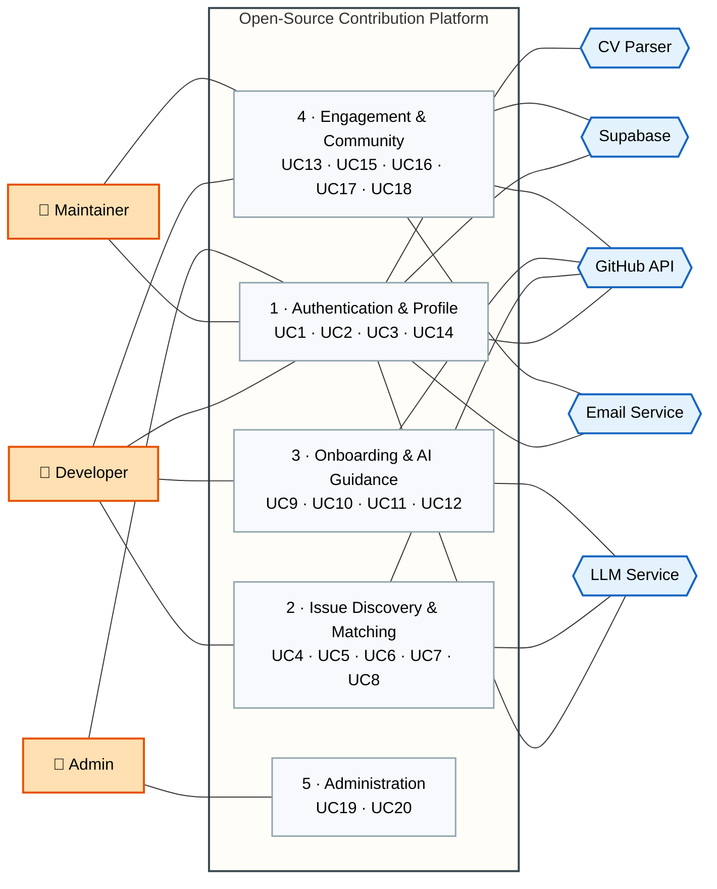
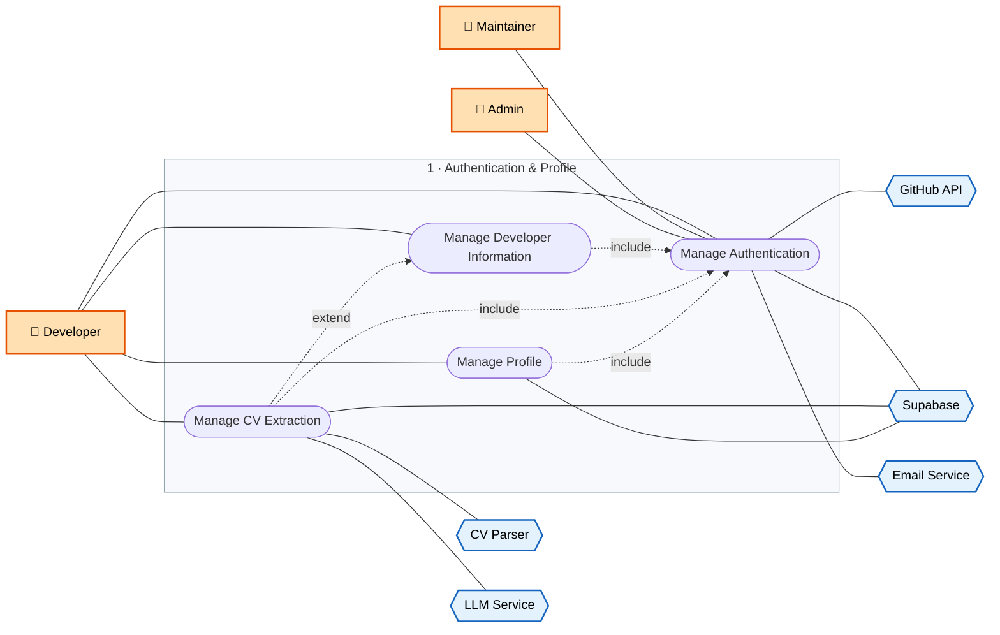
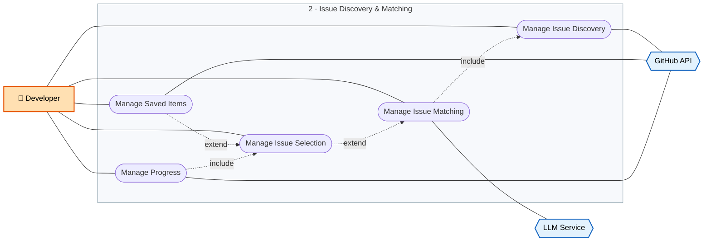
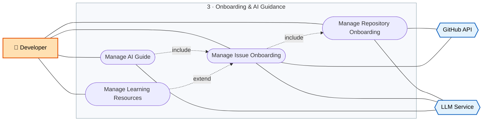
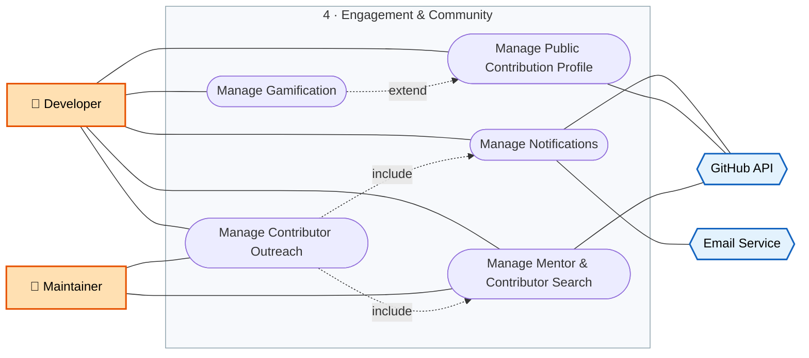
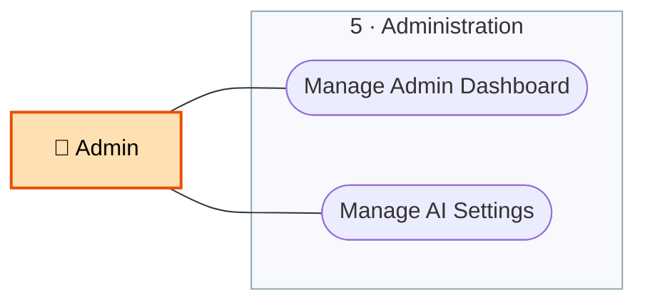

### **Team Members** 

|**ID**|**Name**|**Email**|**GitHub**|**Services**|
|---|---|---|---|---|
|23101432|Omar mokhtar|omarlabague@gmail.com|https://github.c om/omar-Mok htar101|**FR-3: Manage CV** **Extraction** **FR-9: Manage Repository** **Onboarding** **FR-11: Manage AI Guide** **FR-18: Manage** **Contributor Outreach**|
|23101396|Sondous Adel|sondousadel8@gmail.com|Sondous-Adel (Sondous Adel)|**FR-1: Manage** **Authentication** **FR-7: Manage Saved** **Items** **FR-8: Manage Progress** **FR-13: Manage** **Notifications**|
|23101418|Abdullrahman Alkady|Abdullrahman.Alkady@gmail .com|abdullrahmana lkady-cmd|**FR-2: Manage Developer** **Information** **FR-16: Manage** **Gamification** **FR-14: Manage Profile** **FR-19: Manage Admin** **Dashboard**|
|23101466|Mohamed Abdelhady|mohamed.hady.dev@gmail.c om|https://github.c om/Slim-Hady|**FR-4: Manage Issue** **Discovery** **FR-5: Manage Issue** **Matching** **FR-6: Manage Issue** **Selection** **FR-15: Manage Public**|

|||||**Contributio**|
|---|---|---|---|---|
|23101871|Abdelrahman Ahmed|bedogamer361@gmail.com|BeDo775 (Abdelrahman Ahmed )|**FR-10: Manage Issue** **Onboarding** **FR-12: Manage** **Learning Resources** **FR-17: Manage Mentor** **& Contributor Search** **FR-20: Manage AI** **Settings**|

# **Part A: Project Definition** 

## **Title, Description & Related Work** 

### **Project Title** 

OpenSource-helper: An AI-Guided Platform That Takes First-Time Developers From Choosing a GitHub Issue to a Merged Pull Request 

### **Description** 

OpenSource-helper is a web platform that connects to a developer's GitHub account, learns the developer's skills and experience level, and recommends the three open-source issues that fit them best, with a short explanation of why each one fits. After the developer selects an issue, the platform guides the contribution: it explains the repository and the issue, links learning resources, and offers an AI guide that answers questions without ever writing the solution. It follows the issue through In Progress, PR Open, and Merged by syncing with GitHub. Developers and maintainers can also find active contributors in an organization or repository and send mentorship or recruitment requests. An Admin controls how much AI the platform uses. 

### **The Problem** 

A developer who wants to make a first open-source contribution has a search problem before a coding problem. A popular repository can hold hundreds of open issues, and only a small share are suitable for a newcomer. GitHub's own engineers describe good first issues as a tiny minority of all issues. Maintainers add the "good first issue" label by hand, so it is applied 

unevenly, and an issue that carries it can still turn out to be hard once the contributor starts. Finding an issue is only the first obstacle. The contributor then has to understand an unfamiliar codebase, set it up locally, follow the project's contribution rules, and open a pull request, usually with nobody to ask. Many beginners stop at one of these steps. General AI assistants can write the fix, but then the contributor has finished a task without learning how to do it, which defeats the purpose of contributing in the first place. 

OpenSource-helper targets this gap. Its business goals are that at least 60% of registered users select a recommended issue within 7 days, and at least 40% of selected issues reach Merged within 30 days. 

### **Who Suffers From It** 

- Students and junior developers who need real contributions for their portfolio and for hiring, but do not know where to start or which issue they can finish. 

- Developers returning to open source who want an issue that matches their current languages and level without searching manually. 

- Maintainers who want new contributors to succeed and want to find active contributors to mentor or recruit, but have no simple way to reach them. 

### **Main Features** 

- **Account and GitHub connection:** sign up with email or GitHub, role-based access for Developer, Maintainer, and Admin, and secure storage of GitHub tokens. 

- **Developer profile and CV extraction:** the developer describes skills, level, and preferred languages, or uploads a CV and reviews the skills the AI extracts. 

- **Issue discovery and matching:** the platform searches open GitHub issues using the profile and filters, excludes closed, assigned, inactive, or ignored issues, and returns the three best matches with the reason for each. The developer can regenerate to get three different issues. 

- **Issue selection, saved items, and progress tracking:** bookmark repositories and issues into lists, confirm one issue, and follow its status from GitHub automatically, with a dated history and a progress summary. 

- **Onboarding and learning resources:** a repository overview, setup and test instructions, contribution guidelines, a plain-language summary of the issue, related code areas, topics to research, and general Git and GitHub guides. 

- **AI guide with guardrails:** a chat per selected issue that explains, suggests investigation steps, and points to resources, and refuses to give complete solutions or implementation code in every conversation. 

- **Notifications:** in-app or email alerts for new matches, pull request activity, closed or taken saved issues, badges, and outreach requests. 

- **Public contribution profile and gamification:** badges, streaks, and an opt-in shareable profile. 

- **Mentor and contributor search with outreach:** ranked active contributors by organization or repository, and mentorship or recruitment requests that the recipient can accept, decline, or block. 

- **Admin dashboard and AI settings:** usage figures no more than 5 minutes old, and limits on tokens per user, AI temperature, and total AI usage. 

### **Related Work** 

The four systems below help people find a first open-source issue. They were reviewed from their public documentation and descriptions. 

**GitHub Good First Issues.** This feature is built into GitHub. It combines maintainer labels with a deep-learning model that scores issue text for how easy the issue is to fix, and it lets users browse by topic or open a repository's Contribute page. Users with enough GitHub activity also receive personalized repository recommendations on the Explore page. _Limitations:_ 

- Personalization works from past activity such as contributions and stars, so a newcomer with little history gives it little to work with. 

- It does not ask for the developer's skills and experience level, and it does not explain why an issue was suggested. 

● It stops at the list: there is no onboarding, no progress tracking, and no guide. **Up For Grabs.** A community-maintained list of projects that curate tasks for new contributors. Projects are added through a pull request and must have maintainers willing to review and guide newcomers. Each entry links to the project's own list of beginner issues. _Limitations:_ 

- It lists projects and links out, so the user still reads many issues to find a suitable one. 

- Nothing is tailored to the user's skills, and there is no tracking or guidance after the click. 

- It depends on maintainers keeping their labels and issue lists up to date. 

**CodeTriage.** Developers follow repositories and receive one open issue from them by email each day, with instructions on how to triage it. Its site reports more than 100,000 developers following over 10,000 repositories. 

_Limitations:_ 

- The user must already know which repositories to follow. 

- The daily issue is picked from the followed repositories at random, not by skill or difficulty. 

- The task is triage, meaning diagnosing and commenting on issues, rather than a guided path to a merged pull request. 

**Good First Issue (goodfirstissue.org).** A site that collects beginner-friendly issues from active public repositories so developers can browse and evaluate them. It treats the "good first issue" and "help wanted" labels as its signals and refreshes its index with scheduled background syncs. 

_Limitations:_ 

- Label-based discovery inherits the inconsistency of manual labels. 

- The site states that its indexed copy can be stale or incomplete, and that issue quality depends on clear scope, setup notes, and maintainer responsiveness. 

- It does not build a profile from the user or recommend by fit, and it does not guide the contribution. 

Research prototypes such as GFI-Bot (FSE 2022) apply machine learning to detect good first issues, but they are aimed at maintainers who label issues, not at a newcomer's whole path from selection to merge. 

### **Comparison Table** 

**Feature GitHub Good Up For Grabs CodeTriage Good First OpenSource-** 

||**First Issues**|||**Issue**|**helper**|
|---|---|---|---|---|---|
|Searches open GitHub issues for the user|Yes|Partial (links to project issue lists)|Yes (from followed repositories)|Yes|Yes|
|Matches issues to the user's skills and level|Partial (repository level, from GitHub activity)|No|No (random pick)|No|Yes (top 3 ranked by AI)|
|Explains why an issue was recommended|No|No|No|No|Yes|
|Builds the profile from a CV|No|No|No|No|Yes|
|Tracks an issue from selection to merged pull request|No|No|No|No|Yes (synced with GitHub)|
|Repository and issue onboarding|No|No|Partial (triage instructions)|Partial (contributor guide)|Yes|
|AI guide that explains without writing the solution|No|No|No|No|Yes|
|Notifications about matches and pull request activity|No|No|Partial (daily issue email)|No|Yes|
|Badges, streaks, and public contribution profile|No|No|No|No|Yes|
|Mentor and contributor search with|No|No|No|No|Yes|

#### outreach 

_Yes, Partial, and No describe what each system's public documentation states. No means the feature was not found in that documentation._ 

### **How Our System Is Different** 

The existing tools stop at showing a list of issues. OpenSource-helper asks who the developer is, using typed information or a CV, and recommends three issues with a reason for each, so the choice is a fit rather than a label match. It then stays with the developer after the choice, with onboarding, progress synced from GitHub, and an AI guide that is built to explain and never to solve. Finally, it adds a community layer that none of the four offers: badges and a public profile for the developer, and mentor search and outreach for developers and maintainers. 

### **Sources** 

- GitHub Blog, "Browse good first issues to start contributing to open source": <u>https://github.blog/developer-skills/github/browse-good-first-issues-to-start-contributing-toopen-source/</u> 

- GitHub Blog, "How we built the good first issues feature": <u>https://github.blog/open-source/maintainers/how-we-built-good-first-issues</u> 

- Up For Grabs, list-a-project guide: <u>https://github.com/therufa/up-for-grabs.net/blob/gh-pages/docs/list-a-project.md</u> 

- CodeTriage: <u>https://github.com/avcwisesa/CodeTriage</u> and <u>https://www.codetriage.com</u> 

# **Part B: Requirements** 

## **Requirements Specification** 

## **1. Business & Customer Requirements** 

### **1.1 Business Requirements** 

**BR-1: Early issue selection.** At least 60% of registered users shall select a recommended Issue within 7 days of registering, measured over the first 6 months after launch. **BR-2: Contribution completion.** At least 40% of selected Issues shall reach the Merged status within 30 days of selection, measured over the first 6 months after launch. 

**BR-3: Usage monitoring.** Platform usage figures (logged-in users, Issues suggested and regenerated, Issue statuses, and AI usage) shall be available to the Admin with data no more than 5 minutes old. 

**BR-4: AI usage control.** 100% of AI requests shall be limited by the token, temperature, and usage settings configured by the Admin, to keep AI usage within the project budget. **BR-5: Engagement and retention.** At least 35% of registered users shall return to the platform within 30 days of their last visit, measured over the first 6 months after launch. 

**BR-6: Mentorship and community.** At least 20% of active users shall view a mentor or 

contributor profile, and at least 30% of outreach requests shall receive a response within 7 days, measured over the first 6 months after launch. 

### **1.2 Customer Requirements** 

**CR-1: Receive matching issues.** _User type:_ Developer. _Linked to:_ BR-1. I want the platform to search open issues and recommend the best ones for my skills and experience level, so that I can find a suitable contribution without searching manually. 

**CR-2: Select and track an issue.** _User type:_ Developer. _Linked to:_ BR-1, BR-2. I want to select an issue and track its progress in one place, so that I can manage my contributions and see how far I have come. 

**CR-3: Receive guidance without solutions.** _User type:_ Developer. _Linked to:_ BR-2. I want onboarding guidance, learning resources, and an AI guide that explain the issue without writing the solution for me, so that I can complete the contribution myself. 

**CR-4: Secure access to my account.** _User type:_ Developer. _Linked to:_ BR-1. I want to access my account, GitHub connection, and history securely, so that my profile and past work are protected and available whenever I return. 

**CR-5: Monitor platform usage.** _User type:_ Admin. _Linked to:_ BR-3. I want to view users, suggested and regenerated Issues, and Issue statuses, so that I can track how the platform is used. 

**CR-6: Control AI usage.** _User type:_ Admin. _Linked to:_ BR-4. I want to edit the maximum tokens per user, the AI temperature, and the AI usage limit, so that I can keep AI usage within budget. **CR-7: Build my profile from my CV.** _User type:_ Developer. _Linked to:_ BR-1. I want the platform to read my CV and extract my skills, so that I get accurate recommendations without filling in everything by hand. 

**CR-8: Stay informed and keep my favorites.** _User type:_ Developer. _Linked to:_ BR-5. I want to save repositories and issues and be notified about new matches and changes, so that I do not miss opportunities. 

**CR-9: Stay motivated and showcase my work.** _User type:_ Developer. _Linked to:_ BR-5. I want badges, streaks, and a shareable public contribution profile, so that I stay motivated and can show my work to others. 

**CR-10: Find mentors and core contributors.** _User type:_ Developer, Maintainer. _Linked to:_ BR-6. I want to search an organization or repository and find its most active contributors, so that I can learn from them or identify people worth recruiting. 

**CR-11: Reach out to contributors.** _User type:_ Developer, Maintainer. _Linked to:_ BR-6. I want to send a mentorship or recruitment request to a contributor, so that I can start a conversation with them. 

## **Use Case Diagram** 

The model is split into a system overview and five detailed module views. This keeps every use case readable, instead of forcing 20 use cases, 3 actors and 5 external systems onto one canvas.

**Legend**

- Solid line: association between an actor and a use case, or between a use case and an external system.
- Dotted arrow labelled `include`: the source use case always performs the target use case.
- Dotted arrow labelled `extend`: the source use case optionally adds behaviour to the target use case.

### **System Overview**

**Figure 1 — Actors, modules and external systems.** Each module box lists the use cases detailed in the figures below.

### **Module 1 — Authentication & Profile**

**Figure 2 — UC1 to UC3 and UC14.** Every other use case depends on this module through `include`.

Cross-module dependencies: UC13, UC15 and UC17 (module 4) and UC19 and UC20 (module 5) also include UC1.

### **Module 2 — Issue Discovery & Matching**

**Figure 3 — UC4 to UC8.** The contribution pipeline: discovery, matching, selection, saved items and progress.

Cross-module dependencies: UC4 includes UC2 (module 1); UC6 is included by UC9 (module 3); UC8 is included by UC16 (module 4).

### **Module 3 — Onboarding & AI Guidance**

**Figure 4 — UC9 to UC12.** Onboarding content and the AI guide, all without revealing the solution.

Cross-module dependency: UC9 includes UC6 (module 2).

### **Module 4 — Engagement & Community**

**Figure 5 — UC13, UC15 to UC18.** Notifications, public profile, gamification, mentor search and outreach.

Cross-module dependencies: UC13, UC15 and UC17 include UC1 (module 1); UC16 includes UC8 (module 2).

### **Module 5 — Administration**

**Figure 6 — UC19 and UC20.** Platform monitoring and AI usage control, available to the Admin only.

Cross-module dependency: UC19 and UC20 include UC1 (module 1).

## **2. Functional Requirements** 

### **FR-1: Manage Authentication** 

_Owner:_ All users. _Linked to:_ CR-4 

#### **User Requirements** 

- 1.1 The user shall be able to create an account using their name, email address, and password, or by signing up with their GitHub account. 

- 1.2 The user shall be able to log in using their email address and password, or with GitHub. 

- 1.3 The user shall be able to log out of their account. 

- 1.4 The user shall be able to reset their password using their registered email address. 

- 1.5 The user shall be able to connect or disconnect their GitHub account from their account settings. 

#### **System Requirements** 

- 1.6 The system shall create an account when the user submits valid credentials or completes GitHub OAuth authorization. 

- 1.7 The system shall authenticate the user by email and password or by GitHub OAuth and start a session. 

- 1.8 The system shall end the session when the user logs out. 

- 1.9 The system shall send a password reset link to the user's registered email address. 

- 1.10 The system shall link or unlink the GitHub account through OAuth, store the access token securely, and use it to read repository, issue, and Pull Request data. 

- 1.11 The system shall enforce role-based access for the Developer, Maintainer, and Admin roles. 

### **FR-2: Manage Developer Information** 

_Owner:_ Developer. _Linked to:_ CR-1 

#### **User Requirements** 

- 2.1 The user shall be able to describe their skills, experience, and technical interests. 

- 2.2 The user shall be able to select their open-source experience level (Beginner, Intermediate, or Advanced). 

- 2.3 The user shall be able to select their preferred programming languages and technologies. 

2.4 The user shall be able to update this information at any time. 

#### **System Requirements** 

- 2.5 The system shall store the user's description of skills, experience, and interests. 

- 2.6 The system shall store the user's experience level. 

- 2.7 The system shall store the user's preferred programming languages and technologies. 

- 2.8 The system shall require an experience level and at least one language before issue recommendations are requested. 

- 2.9 The system shall make this information available to Issue Discovery and Issue Matching. 

### **FR-3: Manage CV Extraction** 

_Owner:_ Developer. _Linked to:_ CR-7, CR-1 

#### **User Requirements** 

- 3.1 The user shall be able to upload a CV in a supported file format. 

- 3.2 The user shall be able to see the status of the extraction. 

- 3.3 The user shall be able to review the skills, technologies, and experience level extracted from the CV. 

- 3.4 The user shall be able to correct, add, or remove extracted skills. 

- 3.5 The user shall be able to replace their CV with a new one. 

#### **System Requirements** 

3.6 The system shall accept an uploaded CV only if its file type and size are supported. 

3.7 The system shall extract the text from the uploaded CV. 

3.8 The system shall send the CV text to the AI to identify skills, technologies, and experience level. 

- 3.9 The system shall display the extracted results to the user for review. 

- 3.10 The system shall save the user's corrections to the developer information. 

- 3.11 The system shall replace the previous extraction when a new CV is uploaded. 

### **FR-4: Manage Issue Discovery** 

_Owner:_ Developer. _Linked to:_ CR-1 

#### **User Requirements** 

- 4.1 The user shall be able to request an issue search based on their profile. 

4.2 The user shall be able to narrow the search by programming language, label (such as good first issue), or repository activity. 

- 4.3 The user shall be able to restrict the search to a specific organization or repository. 

4.4 The user shall be told when no suitable Issues were found and be offered broader filters. 

#### **System Requirements** 

- 4.5 The system shall build the search from the user's languages, technologies, experience level, and chosen filters. 

- 4.6 The system shall retrieve open Issues from GitHub that match the search. 

- 4.7 The system shall exclude Issues that are closed, assigned, inactive, or already selected or ignored by the user. 

4.8 The system shall collect repository context (description, labels, activity) for each candidate Issue. 

- 4.9 The system shall pass the candidate pool to Issue Matching. 

- 4.10 The system shall report when the candidate pool is empty. 

### **FR-5: Manage Issue Matching** 

_Owner:_ Developer. _Linked to:_ CR-1 

#### **User Requirements** 

- 5.1 The user shall be able to receive the three Issues that best match their skills, knowledge, and experience level. 

5.2 The user shall be able to view the repository name, description, and link of each recommended Issue. 

5.3 The user shall be able to view the required technologies, languages, knowledge, experience level, and prerequisites of each Issue. 

- 5.4 The user shall be able to see why each Issue was recommended for them. 

- 5.5 The user shall be able to regenerate the recommendations and receive three different 

#### Issues. 

#### **System Requirements** 

5.6 The system shall use AI to rank the candidate pool against the user's profile. 

5.7 The system shall return the three highest-ranked Issues. 

5.8 The system shall display the repository details and requirements of each recommended Issue. 

5.9 The system shall generate a short explanation of the fit for each recommended Issue. 

5.10 The system shall return three different Issues each time the user regenerates. 

- 5.11 The system shall record suggested and regenerated Issues for the Admin Dashboard. 

### **FR-6: Manage Issue Selection** 

_Owner:_ Developer. _Linked to:_ CR-2 

#### **User Requirements** 

6.1 The user shall be able to select one Issue from the recommended Issues. 

6.2 The user shall be able to view the complete details of an Issue before selecting it. 

6.3 The user shall be able to confirm an Issue as their selected Issue. 

6.4 The user shall be able to ignore an Issue they do not want. 

6.5 The user shall be able to select an Issue from their saved items. 

#### **System Requirements** 

6.6 The system shall record the Issue the user selects. 

6.7 The system shall display the complete details of an Issue on request. 

6.8 The system shall finalize the selection only after the user confirms it. 

6.9 The system shall associate the selected Issue with the user's account. 

6.10 The system shall record ignored Issues so they are not recommended again. 

### **FR-7: Manage Saved Items** 

_Owner:_ Developer. _Linked to:_ CR-8 

#### **User Requirements** 

7.1 The user shall be able to bookmark repositories and Issues. 

7.2 The user shall be able to organize bookmarks into named lists. 

7.3 The user shall be able to move or remove saved items. 

7.4 The user shall be able to see whether each saved Issue is still open, closed, or taken. 

#### **System Requirements** 

7.5 The system shall store the user's saved items and lists. 

7.6 The system shall restrict saved lists to their owner. 

7.7 The system shall check the state of saved Issues on GitHub regularly. 

7.8 The system shall flag a saved Issue that was closed or taken and alert the user through Manage Notifications (FR-13). 

### **FR-8: Manage Progress** 

_Owner:_ Developer. _Linked to:_ CR-2 

#### **User Requirements** 

- 8.1 The user shall be able to view their selected Issues on a progress dashboard with the status In Progress, PR Open, Merged, or Ignored. 

8.2 The user shall be able to update the status of a selected Issue manually. 

8.3 The user shall be able to attach the link of their Pull Request to the Issue. 

8.4 The user shall be able to view a summary of their progress, with counts per status and the time since each Issue was selected. 

#### **System Requirements** 

8.5 The system shall save and display the status of each selected Issue. 

8.6 The system shall sync Issue and Pull Request status from GitHub automatically. 

8.7 The system shall change the status to PR Open when a Pull Request is detected and to Merged when it is merged. 

8.8 The system shall calculate the progress summary for each user. 

8.9 The system shall keep a dated history of status changes. 

8.10 The system shall provide status data to the Admin Dashboard and to Gamification. 

### **FR-9: Manage Repository Onboarding** 

_Owner:_ Developer. _Linked to:_ CR-3 

#### **User Requirements** 

9.1 The user shall be able to view an overview of the repository of the selected Issue: its purpose, structure, main technologies, and the files and directories to read first. 9.2 The user shall be able to view instructions for cloning the repository, setting it up locally, and running and testing it. 

9.3 The user shall be able to view instructions for creating a branch and access the repository's contribution guidelines, including its CONTRIBUTING.md file when available. 

9.4 The user shall be able to view the repository's Pull Request submission guidelines, including branch requirements, testing, and Pull Request creation. 

#### **System Requirements** 

9.5 The system shall generate the repository overview from the repository's README, structure, and metadata. 

9.6 The system shall generate setup, run, and test instructions from the repository's documentation. 

9.7 The system shall retrieve and display the repository's contribution guidelines when they exist. 

9.8 The system shall generate Pull Request submission guidance consistent with those guidelines. 

9.9 The system shall reuse stored guidance when another user selects an Issue from the same repository. 

### **FR-10: Manage Issue Onboarding** 

_Owner:_ Developer. _Linked to:_ CR-3 

#### **User Requirements** 

10.1 The user shall be able to view a plain-language description of the selected Issue. 10.2 The user shall be able to view the technologies, knowledge, and experience level the Issue requires. 

10.3 The user shall be able to view the areas of the codebase related to the Issue and recommended topics to research before starting. 

10.4 The user shall be able to access documentation and external learning resources related to the Issue. 

#### **System Requirements** 

10.5 The system shall summarize the Issue description and its discussion. 

10.6 The system shall display the required technologies, knowledge, and experience level. 10.7 The system shall identify the related files and directories and generate research topics for the Issue. 

10.8 The system shall provide links to relevant documentation and learning resources. 10.9 The system shall exclude complete solutions and implementation code from all onboarding content. 

### **FR-11: Manage AI Guide** 

_Owner:_ Developer. _Linked to:_ CR-3 

#### **User Requirements** 

11.1 The user shall be able to start a conversation with the AI guide about their selected Issue. 11.2 The user shall be able to ask about the Issue, the repository structure, and the technologies and concepts it requires. 

11.3 The user shall be able to ask how to investigate the Issue and ask for clarification of the onboarding instructions. 

11.4 The user shall be able to ask the AI guide for documentation or learning resources. 

11.5 The user shall be able to continue a previous conversation and view the chat history of the Issue. 

#### **System Requirements** 

11.6 The system shall start a conversation linked to the selected Issue and give the AI the Issue, repository, and onboarding context. 

11.7 The system shall answer with explanations, investigation steps, clarifications, and resources. 

11.8 The system shall refuse to provide complete solutions or implementation code, in every conversation and follow-up. 

11.9 The system shall store and restore the conversation for each selected Issue. 

11.10 The system shall apply the Admin's AI limits and tell the user when a limit is reached. 

### **FR-12: Manage Learning Resources** 

_Owner:_ Developer. _Linked to:_ CR-3 

#### **User Requirements** 

12.1 The user shall be able to view general Git and GitHub guidance, including creating and managing branches. 

12.2 The user shall be able to view instructions for creating a Pull Request and writing its description. 

12.3 The user shall be able to view instructions for running tests before submitting a Pull Request. 

12.4 The user shall be able to view general open-source contribution guidelines and etiquette. 12.5 The user shall be able to search the resources by topic. 

#### **System Requirements** 

12.6 The system shall display general Git and GitHub guidance. 

12.7 The system shall display Pull Request creation and description instructions. 

12.8 The system shall display testing instructions. 

12.9 The system shall display open-source contribution guidelines. 

12.10 The system shall return the resources that match the user's search. 

### **FR-13: Manage Notifications** 

_Owner:_ Developer. _Linked to:_ CR-8 

#### **User Requirements** 

13.1 The user shall be able to receive notifications about new matching Issues and Pull Request activity such as reviews, comments, and merges. 

13.2 The user shall be able to receive notifications when a saved Issue is closed or taken, when they earn a badge, and when they receive an outreach request. 

13.3 The user shall be able to choose the notification channels (in-app or email) and the frequency (instant, daily, or weekly). 

13.4 The user shall be able to turn each type of notification on or off. 

13.5 The user shall be able to view their notifications and mark them as read. 

#### **System Requirements** 

13.6 The system shall detect new matching Issues and Pull Request activity from GitHub. 

13.7 The system shall create notifications for events raised by other subsystems. 

13.8 The system shall deliver each notification through the user's chosen channel and 

frequency. 

13.9 The system shall store notifications and their read state. 

13.10 The system shall not send notification types the user turned off. 

### **FR-14: Manage Profile** 

_Owner:_ Developer. _Linked to:_ CR-2, CR-4 

#### **User Requirements** 

14.1 The user shall be able to view and update their name, username, bio, and avatar. 

14.2 The user shall be able to update their password. 

14.3 The user shall be able to view the history of all Issues associated with their account. 14.4 The user shall be able to view the AI guide chat history of each Issue in their history. 14.5 The user shall be able to view their contribution statistics, such as Issues selected, merged, and ignored. 

14.6 The user shall be able to delete their account and data. 

#### **System Requirements** 

14.7 The system shall save profile updates and keep usernames unique. 

14.8 The system shall save the updated password. 

14.9 The system shall display the Issue history and chat history to their owner only. 

14.10 The system shall calculate the contribution statistics from the user's history. 

14.11 The system shall delete the user's data when the account is deleted. 

### **FR-15: Manage Public Contribution Profile** 

_Owner:_ Developer. _Linked to:_ CR-9, CR-10 

#### **User Requirements** 

15.1 The user shall be able to publish a shareable public contribution profile. 

15.2 The user shall be able to choose which parts it shows, such as skills, merged contributions, badges, and streaks. 

15.3 The user shall be able to make the profile public or private at any time. 

15.4 The user shall be able to opt in or out of being discoverable as a mentor or contributor. 15.5 The user shall be able to copy the profile's link to share it. 

#### **System Requirements** 

15.6 The system shall generate the public profile from the user's platform and GitHub activity. 15.7 The system shall show only the parts the user chose. 

15.8 The system shall hide the profile from everyone else when it is private. 

15.9 The system shall list a user in Mentor & Contributor Search only if the user opted in. 

15.10 The system shall give each public profile a unique shareable link. 

### **FR-16: Manage Gamification** 

_Owner:_ Developer. _Linked to:_ CR-9 

#### **User Requirements** 

16.1 The user shall be able to earn badges for milestones such as their first Pull Request, first merge, and five contributions. 

16.2 The user shall be able to view their earned badges and what is needed to earn the others. 16.3 The user shall be able to view their current and longest contribution streaks. 16.4 The user shall be able to choose which badges appear on their public profile. 

#### **System Requirements** 

16.5 The system shall check milestones against the user's progress and award each badge 

once. 

16.6 The system shall calculate current and longest streaks from the user's contribution activity. 

16.7 The system shall store earned badges. 

16.8 The system shall notify the user when a badge is earned. 

16.9 The system shall provide the chosen badges and streaks to the public profile. 

### **FR-17: Manage Mentor & Contributor Search** 

_Owner:_ Developer, Maintainer. _Linked to:_ CR-10 

#### **User Requirements** 

17.1 The user shall be able to search for contributors by organization or repository. 

17.2 The user shall be able to filter the search by programming language or topic. 

17.3 The user shall be able to view a ranked list of the most active contributors and maintainers. 17.4 The user shall be able to view each person's contribution activity (such as merged Pull Requests, commits, and reviews) and areas of expertise. 

17.5 The user shall be able to open a person's GitHub or platform profile. 

#### **System Requirements** 

17.6 The system shall retrieve contributor data for the chosen organization or repository from GitHub. 

17.7 The system shall rank contributors by their contribution activity. 

17.8 The system shall derive each person's areas of expertise from the languages and repositories they contribute to. 

17.9 The system shall use public GitHub data only. 

17.10 The system shall link a contributor to their platform profile when one exists and is public. 

### **FR-18: Manage Contributor Outreach** 

_Owner:_ Developer, Maintainer. _Linked to:_ CR-11 

#### **User Requirements** 

18.1 The user shall be able to send a mentorship or recruitment request with a message to a contributor. 

18.2 The user shall be able to accept, decline, or block a request they receive. 18.3 The user shall be able to exchange messages with a contributor once a request is accepted. 

18.4 The user shall be able to view their sent and received requests and their statuses. 

#### **System Requirements** 

18.5 The system shall deliver each request to the recipient through Manage Notifications (FR-13). 

18.6 The system shall allow platform requests only to users who opted in under FR-15 and otherwise show the person's GitHub profile link. 

18.7 The system shall limit how many requests a user can send. 

18.8 The system shall record the status of each request. 

18.9 The system shall prevent a blocked sender from contacting the recipient again. 

18.10 The system shall store the conversation of each accepted request. 

### **FR-19: Manage Admin Dashboard** 

_Owner:_ Admin. _Linked to:_ CR-5 

#### **User Requirements** 

19.1 The Admin shall be able to access the Admin Dashboard. 

19.2 The Admin shall be able to view the number of logged-in users and registered users. 19.3 The Admin shall be able to view the number of Issues suggested and regenerated. 19.4 The Admin shall be able to view the number of Issues in each status (In Progress, PR Open, Merged, and Ignored). 

19.5 The Admin shall be able to view AI usage, such as tokens consumed. 

19.6 The Admin shall be able to view the figures for a selected period. 

#### **System Requirements** 

19.7 The system shall restrict the dashboard to users with the Admin role. 19.8 The system shall display the user, Issue, and status counts. 

19.9 The system shall display figures that are no more than 5 minutes old. 

19.10 The system shall total AI usage across all AI features. 

19.11 The system shall filter the figures by the selected period. 

### **FR-20: Manage AI Settings** 

_Owner:_ Admin. _Linked to:_ CR-6 

#### **User Requirements** 

20.1 The Admin shall be able to edit the maximum number of tokens available to each user. 20.2 The Admin shall be able to edit the temperature setting of the AI. 

20.3 The Admin shall be able to edit the AI usage limit. 

20.4 The Admin shall be able to view the current settings and the AI usage measured against the limit. 

#### **System Requirements** 

20.5 The system shall validate and store the settings the Admin saves. 

20.6 The system shall apply the maximum token limit to each user's AI requests. 

20.7 The system shall apply the temperature value to AI requests. 

20.8 The system shall enforce the AI usage limit and inform the user when it is reached. 20.9 The system shall apply these settings to every AI feature: CV extraction, issue matching, onboarding content, and the AI guide. 

20.10 The system shall apply changed settings from the next AI request. 

## **3. Non-Functional Requirements** 

**NFR-1: Performance** 

NFR-1.1 The system shall return 95% of standard API requests within 500 milliseconds under normal load. 

NFR-1.2 The system shall display the three recommended Issues within 10 seconds for at least 95% of recommendation requests, excluding external service failures. NFR-1.3 The system shall generate an AI guide response within 10 seconds for at least 90% of chat requests under normal operating conditions. 

NFR-1.4 The system shall show extracted CV skills within 30 seconds for at least 95% of uploads. 

**NFR-2: Availability** 

NFR-2.1 The system shall maintain at least 99.5% monthly availability. NFR-2.2 The system shall preserve user Issue history for at least 99.9% of completed operations. 

**NFR-3: Security** 

NFR-3.1 The system shall enforce authentication and authorization for 100% of protected operations. 

NFR-3.2 The system shall prevent unauthorized access to 100% of tested users' Issue history and chat history. 

NFR-3.3 The system shall use HTTPS/TLS for 100% of communication between client and server. 

NFR-3.4 The system shall store passwords hashed and GitHub access tokens encrypted. 

**NFR-4: AI Guardrails** 

NFR-4.1 The AI guide shall prevent the generation of complete solutions or implementation code for 100% of prompts in the defined guardrail test suite. 

NFR-4.2 The AI guide shall provide guidance, explanations, investigation steps, and learning resources instead of implementing the selected Issue. 

NFR-4.3 The AI guide shall maintain the same restrictions across 100% of conversations and follow-up questions. 

**NFR-5: Data Freshness** 

NFR-5.1 The system shall reflect GitHub Issue and Pull Request status changes within 5 minutes for at least 95% of changes. 

NFR-5.2 The system shall deliver at least 95% of notifications within 5 minutes of the triggering event, subject to the user's chosen frequency. 

#### **NFR-6: Privacy and Safety** 

NFR-6.1 The system shall make 100% of public profiles and mentor listings opt-in. NFR-6.2 The system shall let 100% of outreach recipients decline or block a sender. NFR-6.3 The system shall remove a user's personal data within 30 days of an account deletion request. 

## **4. Subsystems & Traceability** 

### **4.1 Subsystems and Their Functional Requirements** 

|**Subsystem**|**High-level FRs**|**Low-level FRs**|
|---|---|---|
|Account Management|FR-1 Manage Authentication, FR-14 Manage Profile|FR-1.1 to 1.11, FR-14.1 to 14.11|
|Developer Profile|FR-2 Manage Developer Information, FR-3 Manage CV Extraction|FR-2.1 to 2.9, FR-3.1 to 3.11|
|Issue Search|FR-4 Manage Issue Discovery (Phase 1), FR-5 Manage Issue Matching (Phase 2)|FR-4.1 to 4.10, FR-5.1 to 5.11|
|Contribution Tracking|FR-6 Manage Issue Selection, FR-7 Manage Saved Items, FR-8 Manage Progress|FR-6.1 to 6.10, FR-7.1 to 7.8, FR-8.1 to 8.10|
|Onboarding & Learning|FR-9 Manage Repository Onboarding, FR-10 Manage Issue Onboarding, FR-12 Manage Learning Resources|FR-9.1 to 9.9, FR-10.1 to 10.9, FR-12.1 to 12.10|
|AI Guide|FR-11 Manage AI Guide|FR-11.1 to 11.10|
|Notification|FR-13 Manage Notifications|FR-13.1 to 13.10|
|Community & Recognition|FR-15 Manage Public Contribution Profile, FR-16 Manage Gamification|FR-15.1 to 15.10, FR-16.1 to 16.9|
|Mentor Network|FR-17 Manage Mentor & Contributor Search, FR-18 Manage Contributor Outreach|FR-17.1 to 17.10, FR-18.1 to 18.10|
|Admin & AI Settings|FR-19 Manage Admin Dashboard, FR-20 Manage AI Settings|FR-19.1 to 19.11, FR-20.1 to 20.10|

### **4.2 Interfaces** 

|**Interface**|**Type**|**Description**|
|---|---|---|
|IAccount|Provided by Account Management|Authentication, roles, GitHub connection, profile management, and account deletion.|

|ISkillProfile|Provided by Developer Profile|Stores and returns the user's skills, experience level, preferences, and CV-extracted skills.|
|---|---|---|
|IIssueSearch|Provided by Issue Search|Runs Phase 1 discovery and Phase 2 matching, and regenerates recommendations.|
|IContributionTracking|Provided by Contribution Tracking|Records selected Issues, saved lists, and progress status, including GitHub status sync.|
|IOnboarding|Provided by Onboarding & Learning|Returns onboarding guidance for the selected Issue and general learning resources.|
|IAIGuide|Provided by AI Guide|Handles AI guide conversations and chat history.|
|INotification|Provided by Notification|Creates and delivers in-app and email notifications and stores preferences.|
|ICommunity|Provided by Community & Recognition|Returns public contribution profiles, badges, and streaks.|
|IMentorNetwork|Provided by Mentor Network|Searches contributors and manages outreach requests.|
|IAdminDashboard|Provided by Admin & AI Settings|Returns usage figures to the Admin.|
|IAISettings|Provided by Admin & AI Settings|Stores and returns maximum tokens, temperature, and AI usage limit.|
|IGitHubAPI|External system (GitHub)|Issue, repository, Pull Request, and contributor data, and account connection.|
|IEmailService|External system (email provider)|Sends password reset, notification, and outreach emails.|
|ICVParser|External system (document text extraction)|Extracts plain text from an uploaded CV file.|
|ILLMService|External system (language|Extracts CV skills, ranks|

|model service)|Issues, generates onboarding|
|---|---|
||content, and answers AI guide|
||questions.|

### **4.3 Traceability Matrix** 

|**Subsystem**|**High-level FRs**|**Provided interface**|**Required interfaces**|
|---|---|---|---|
|Account Management|FR-1, FR-14|IAccount|IGitHubAPI, IEmailService, IContributionTracking, IAIGuide|
|Developer Profile|FR-2, FR-3|ISkillProfile|ICVParser, ILLMService, IAISettings|
|Issue Search|FR-4, FR-5|IIssueSearch|ISkillProfile, IContributionTracking, IAISettings, IGitHubAPI, ILLMService|
|Contribution Tracking|FR-6, FR-7, FR-8|IContributionTracking|IIssueSearch, IGitHubAPI, INotification|
|Onboarding & Learning|FR-9, FR-10, FR-12|IOnboarding|IContributionTracking, IAISettings, IGitHubAPI, ILLMService|
|AI Guide|FR-11|IAIGuide|IContributionTracking, IOnboarding, IAISettings, ILLMService|
|Notification|FR-13|INotification|IAccount, IEmailService|
|Community & Recognition|FR-15, FR-16|ICommunity|IAccount, IContributionTracking, IGitHubAPI, INotification|
|Mentor Network|FR-17, FR-18|IMentorNetwork|IAccount, ICommunity, IGitHubAPI,|

||||INotification|
|---|---|---|---|
|Admin & AI Settings|FR-19, FR-20|IAdminDashboard, IAISettings|IAccount, IIssueSearch,|
||||IContributionTracking, IAIGuide|

### **4.4 FR to CR to BR Traceability** 

|**FR**|**Customer Requirement**|**Business Requirement**|
|---|---|---|
|FR-1|CR-4|BR-1|
|FR-2|CR-1|BR-1|
|FR-3|CR-7, CR-1|BR-1|
|FR-4, FR-5|CR-1|BR-1|
|FR-6|CR-2|BR-1|
|FR-7|CR-8|BR-5|
|FR-8|CR-2|BR-2|
|FR-9, FR-10, FR-11, FR-12|CR-3|BR-2|
|FR-13|CR-8|BR-5|
|FR-14|CR-2, CR-4|BR-1, BR-2|
|FR-15|CR-9, CR-10|BR-5, BR-6|
|FR-16|CR-9|BR-5|
|FR-17, FR-18|CR-10, CR-11|BR-6|
|FR-19|CR-5|BR-3|
|FR-20|CR-6|BR-4|

# **Part C: Scrum & Estimation** 

## **1. Product Backlog: User Stories** 

<u>https://drive.google.com/file/d/1CP5MnqhjeXjU9Zs4v4yAjXembSRXlDf4/view?usp=drive_link</u> 

### **FR-1 Manage Authentication** 

|**Sign up**|**Story**|
|---|---|
|**As a**new user||

**I need to** create an account with my name, email, and password or with GitHub **So that** I can start using the platform 

- Given I am on the sign-up page, when I submit a valid name, email, and password, then my account is created and I am logged in. 

- Given I choose "Sign up with GitHub", when I authorize the OAuth request, then an account is created and linked to my GitHub account. 

- Given I submit an email that is already registered or an invalid password, when I press sign up, then I see an error and no account is created. 

|Log in and out Story|
|---|

As a registered user I need to log in with my email and password or GitHub and log out So that my account stays secure 

- Given I have an account, when I enter correct credentials or use GitHub login, then a session starts and I reach my dashboard. 

- Given I am logged in, when I press log out, then my session ends and protected pages are no longer accessible. 

- Given I enter wrong credentials, when I try to log in, then I see an error and no session is created. 

Reset password Story 

As a user who forgot my password I need to reset it through my registered email So that I can regain access to my account 

- Given I enter my registered email, when I request a reset, then a reset link is sent to that email. 

- Given I open a valid reset link, when I set a new valid password, then my password is updated and I can log in with it. 

Connect or disconnect GitHub Story 

#### As a developer 

I need to connect or disconnect my GitHub account from my settings So that the platform can read my repository, issue, and Pull Request data 

- Given I am in account settings, when I connect GitHub and authorize, then my GitHub account is linked and the token is stored encrypted. 

- Given my GitHub is connected, when I disconnect it, then the link is removed and the 

platform stops reading my GitHub data. 

|Role-based access Story|
|---|

As an Admin I need access to be restricted by role So that only authorized users reach protected features 

- Given I am a Developer, when I open an Admin-only page, then access is denied. ● Given I am an Admin, when I open the Admin pages, then access is granted. 

### **FR-2 Manage Developer Information** 

|Set skills and experience Story|
|---|

#### As a developer 

I need to describe my skills and interests and select my experience level So that recommendations fit me 

- Given I am on my developer profile, when I enter my skills and choose Beginner, Intermediate, or Advanced, then the information is saved. 

- Given I saved my profile, when I reopen it, then I see the same values. 

|Select preferred languages|Story|
|---|---|

#### As a developer 

I need to select my preferred programming languages and technologies So that I get Issues in the stack I like 

- Given I open the language selector, when I choose one or more items and save, then they are stored in my profile. 

|Required profile before recommendations Story|
|---|

#### As a developer 

I need to update my information at any time and be prompted to complete the required fields So that my recommendations stay accurate 

- Given I have no experience level or no language, when I request recommendations, then I am asked to complete these fields first. 

- Given I update my profile, when I request new recommendations, then the updated information is used. 

### **FR-3 Manage CV Extraction** 

|Upload a CV Story|
|---|

As a developer I need to upload or replace my CV So that the platform can read my skills 

- Given I select a CV in a supported type and size, when I upload it, then the file is accepted and its text is extracted. 

- Given I select an unsupported type or oversized file, when I upload it, then I see an error and it is rejected. 

- Given I already have a CV, when I upload a new one, then the previous extraction is replaced. 

Track extraction status Story As a developer I need to see the status of the CV extraction So that I know when my results are ready 

- Given I uploaded a CV, when the extraction is running, then I see a "processing" status. 

- Given the extraction completes, when I view the page, then the status shows "completed" with the results. 

Review and correct extracted skills Story As a developer I need to review and edit the extracted skills, technologies, and experience level So that my profile is accurate 

- Given extraction is complete, when I open the results, then I see the skills, technologies, and level found. 

- Given I add, edit, or remove a skill and save, when I reopen my profile, then my corrections are stored. 

### **FR-4 Manage Issue Discovery** 

#### Search for issues from my profile 

|Story|
|---|

#### As a developer 

I need to request an issue search based on my profile So that I find open Issues without searching manually 

- Given my profile is complete, when I request a search, then open Issues matching my languages, technologies, and level are retrieved from GitHub. 

#### Filter the search 

#### Story 

#### As a developer 

I need to filter by language, label, repository activity, organization, or repository So that I can narrow the results 

- Given I apply a language or "good first issue" label filter, when I search, then only matching Issues are returned. 

- Given I restrict the search to an organization or repository, when I search, then Issues come only from it. 

|Exclude unsuitable issues Story|
|---|

#### As a developer 

I need closed, assigned, inactive, selected, or ignored Issues removed So that I only see Issues I can work on 

- Given the search finds closed, assigned, or inactive Issues, when the pool is built, then they are excluded. 

- Given I already selected or ignored an Issue, when I search, then it does not appear. 

- Given candidates remain, when the pool is built, then repository context is attached and the pool is passed to matching. 

|Handle empty results|Story|
|---|---|

#### As a developer 

I need to be told when no suitable Issues are found So that I can broaden my filters 

- Given no Issues match, when the search ends, then I see a "no suitable issues" message with an offer to broaden the filters. 

### **FR-5 Manage Issue Matching** 

|Get top three recommendations Story|
|---|

#### As a developer 

I need to receive the three Issues that best match my profile So that I can pick a suitable contribution 

- Given a candidate pool exists, when matching runs, then the AI ranks it and I receive the three highest-ranked Issues. 

- Given recommendations are requested, when they are ready, then they are displayed within 10 seconds for most requests. 

#### View issue details and reason 

#### Story 

#### As a developer 

I need to see each recommended Issue's repository details, requirements, and why it was recommended So that I can judge the fit 

- Given I see recommendations, when I open one, then I see the repository name, description, link, required technologies, level, and prerequisites. 

- Given I view a recommendation, when it loads, then I see a short explanation of why it fits me. 

#### Regenerate recommendations 

#### Story 

#### As a developer 

I need to regenerate the recommendations So that I can see three different Issues 

- Given I have three recommendations, when I press regenerate, then I receive three Issues different from the previous ones. 

- Given I regenerate, when it completes, then the suggestion and regeneration are recorded for the Admin Dashboard. 

### **FR-6 Manage Issue Selection** 

View details and select an issue 

|Story|
|---|

As a developer I need to view the full details of an Issue before selecting it So that I choose with confidence 

- Given I see recommended Issues, when I open one, then I see its complete details. 

- Given I decide to work on it, when I choose select, then I am asked to confirm. 

Confirm selection As a developer I need to confirm my selected Issue So that it is tracked on my account 

|Story|
|---|

- Given I pressed select, when I confirm, then the Issue is associated with my account with status In Progress. 

- Given I do not confirm, when I cancel, then no selection is made. 

|Ignore an issue Story|
|---|

- As a developer I need to ignore an Issue I do not want So that it is not recommended again ● Given I ignore an Issue, when I request new recommendations, then that Issue never appears again. 

|Select from saved items Story|
|---|

As a developer I need to select an Issue from my saved items So that I can start one I bookmarked earlier ● Given I have saved Issues, when I choose one and confirm, then it becomes my selected Issue. 

### **FR-7 Manage Saved Items** 

Bookmark and organize Story 

#### As a developer 

I need to bookmark repositories and Issues in named lists and move or remove them So that I keep what interests me 

- Given I view a repository or Issue, when I bookmark it, then it appears in my saved items. 

- Given I create a named list, when I move or remove items, then the changes are saved. 

- Given another user, when they try to open my lists, then access is denied. 

#### Track saved issue state 

|Story|
|---|

As a developer I need to see whether a saved Issue is still open, closed, or taken So that I do not waste time on unavailable Issues 

- Given I saved an Issue, when I view my list, then its current state is shown. 

- Given a saved Issue is closed or taken on GitHub, when the regular check runs, then it is flagged and I am notified. 

### **FR-8 Manage Progress** 

|Progress dashboard Story|
|---|

#### As a developer 

I need a dashboard of my selected Issues with their status and a summary So that I see how far I have come 

- Given I have selected Issues, when I open the dashboard, then each shows In Progress, PR Open, Merged, or Ignored. 

- Given the dashboard loads, when I view the summary, then I see counts per status and the time since each Issue was selected. 

Update status and attach PR Story 

#### As a developer 

I need to update an Issue's status manually and attach my Pull Request link So that my progress is accurate 

- Given a selected Issue, when I change its status, then the new status is saved. 

- Given I paste my Pull Request link, when I save, then it is attached to the Issue. 

#### Automatic GitHub sync 

|Story|
|---|

#### As a developer 

I need my status to sync automatically from GitHub So that I do not update it by hand 

- Given I open a Pull Request, when the sync runs, then the status changes to PR Open within 5 minutes. 

- Given my Pull Request is merged, when the sync runs, then the status changes to Merged. 

- Given a status changes, when it is saved, then it is added to a dated history and made available to the Admin Dashboard and Gamification. 

### **FR-9 Manage Repository Onboarding** 

Repository overview Story As a developer I need an overview of the selected Issue's repository So that I understand its purpose and structure 

- Given I selected an Issue, when I open repository onboarding, then I see its purpose, structure, main technologies, and files to read first. 

Setup instructions Story As a developer I need instructions to clone, set up, run, and test the repository So that I can work locally 

- Given the repository has documentation, when I open setup, then I see steps to clone, set up, run, and test it. 

|Branch and PR guidance Story|
|---|

#### As a developer 

I need branch instructions, contribution guidelines, and Pull Request rules So that my contribution follows the project's process 

- Given the repository has a CONTRIBUTING.md, when I open guidelines, then it is displayed. 

- Given I open PR guidance, when it loads, then it matches the repository's guidelines. 

- Given another user already selected an Issue from the same repository, when I open onboarding, then stored guidance is reused. 

### **FR-10 Manage Issue Onboarding** 

|Plain-language issue summary Story|
|---|

#### As a developer 

I need a plain-language description of my Issue and its discussion So that I understand what is asked 

- Given I selected an Issue, when I open its onboarding, then I see a clear summary of the description and discussion. 

#### Requirements and related code 

#### Story 

#### As a developer 

I need the required technologies, related files, and research topics So that I know where to start 

- Given an Issue onboarding page, when it loads, then I see required technologies, knowledge, and level. 

- Given the page loads, when I scroll, then I see related files and directories and topics to research. 

#### Resources without solutions 

#### Story 

#### As a developer 

I need documentation and learning links without a ready solution So that I complete the contribution myself 

- Given I open the resources, when the page loads, then I see links to relevant documentation and learning material. 

- Given any onboarding content, when it is generated, then it contains no complete solution or implementation code. 

### **FR-11 Manage AI Guide** 

#### Chat with the AI guide 

|Story|
|---|

As a developer I need to chat with an AI guide about my selected Issue So that I understand the Issue, repository, and concepts 

- Given I selected an Issue, when I start a chat, then it is linked to that Issue and uses its context. 

- Given I ask how to investigate or what a concept means, when the AI replies, then I receive explanations and investigation steps within 10 seconds for most requests. 

#### Ask for resources 

Story 

#### As a developer 

I need to ask the AI guide for documentation and learning resources So that I can learn what I need 

- Given I ask for resources, when the AI replies, then it provides relevant documentation and learning links. 

|No solutions Story|
|---|

As the platform owner I need the AI guide to refuse full solutions and implementation code So that developers complete the work themselves 

- Given I ask the AI to solve the Issue or write the code, when it replies, then it refuses and offers guidance instead. 

- Given I rephrase or follow up with the same request, when it replies, then it still refuses. 

|Chat history and AI limits Story|
|---|

#### As a developer 

I need to continue a previous conversation, and be told when a limit is reached So that I can resume and understand restrictions 

- Given I had a chat on an Issue, when I reopen it, then the history is restored and I can continue. 

- Given the Admin's AI limit is reached, when I send a message, then I am told that the limit was reached. 

### **FR-12 Manage Learning Resources** 

|Git, GitHub, and PR guides Story|
|---|

As a developer I need guides on Git, branches, Pull Requests, and testing So that I can submit a proper contribution 

- Given I open the learning section, when it loads, then I see guides for branches, creating a Pull Request and its description, and running tests. 

|Etiquette and search Story|
|---|

#### As a developer 

I need open-source etiquette guidelines and a way to search resources by topic So that I find help quickly 

- Given I open the guidelines, when the page loads, then I see general contribution guidelines and etiquette. 

- Given I search a topic, when I submit, then matching resources are shown. 

- Given nothing matches, when I search, then I see a "no results" message. 

### **FR-13 Manage Notifications** 

|Receive notifications|Story|
|---|---|

As a developer I need notifications about new matches, Pull Request activity, closed saved Issues, badges, and outreach requests So that I do not miss anything 

- Given a new matching Issue or Pull Request review, comment, or merge occurs, when it is detected, then I receive a notification. 

- Given a saved Issue is closed or taken, I earn a badge, or I get an outreach request, when it happens, then I receive a notification. 

Choose channels and frequency Story As a developer I need to choose channels, frequency, and which types are on 

#### So that I only get what I want 

- Given I choose in-app or email and instant, daily, or weekly, when an event occurs, then it is delivered accordingly. 

- Given I turn a type off, when that event occurs, then no notification is sent. 

#### View and mark as read Story As a developer I need to view my notifications and mark them read So that I can manage them 

- Given I have notifications, when I open the list, then I see them with their read state. ● Given I mark one as read, when I reload, then it stays read. 

### **FR-14 Manage Profile** 

Edit profile and password Story As a developer I need to update my name, username, bio, avatar, and password So that my account information is correct 

- Given I edit my profile with a unique username, when I save, then the changes are stored and displayed. 

- Given I choose a username that already exists, when I save, then I see an error and nothing changes. 

- ● Given I enter a valid new password, when I save, then the password is updated. 

View history and statistics Story As a developer I need to view my Issue history, the AI guide chats of each Issue, and my contribution statistics So that I can review my past work 

- Given I have past Issues, when I open my history, then I see all Issues associated with my account and their chats. 

- Given I open my statistics, when the page loads, then I see counts of Issues selected, merged, and ignored. 

- Given another user tries to open my history, when the request is made, then access is denied. 

|Delete my account Story|
|---|
|As a developer I need to delete my account and data|
|So that my personal information is removed|
|● Given I request account deletion and confirm, when the request is processed, then my account and personal data are deleted.|
|● Given my account is deleted, when I try to log in, then login fails.|

### **FR-15 Manage Public Contribution Profile** 

Publish a public profile Story As a developer I need a shareable public contribution profile So that I can show my work to others 

- Given I publish my profile, when it is created, then it is generated from my platform and GitHub activity with a unique link. 

- ● Given my profile is public, when I press copy link, then the link is copied. 

Control visibility Story As a developer I need to choose which parts show and set the profile public or private So that I control my privacy 

- Given I select parts (skills, merged contributions, badges, streaks), when others view my profile, then only those parts show. 

- Given I set it to private, when someone opens the link, then the profile is hidden. 

Opt in as mentor Story As a developer I need to opt in or out of being discoverable as a mentor So that I decide if others can find me 

- Given I opt in, when someone searches contributors, then I can be listed. 

- Given I opt out, when someone searches, then I am not listed. 

### **FR-16 Manage Gamification** 

|Earn badges Story|
|---|

As a developer I need to earn badges for milestones So that I stay motivated 

- Given I reach a milestone such as first Pull Request, first merge, or five contributions, when progress is checked, then the badge is awarded once and stored. 

- Given a badge is awarded, when it happens, then I am notified. 

|View badges and streaks Story|
|---|

#### As a developer 

I need to see my badges, what is needed for the others, and my streaks So that I know my next goal 

- Given I open my achievements, when the page loads, then I see earned badges and the requirements of unearned ones. 

- Given I have contribution activity, when I view streaks, then I see my current and longest streak. 

Show badges on public profile Story 

As a developer I need to choose which badges appear on my public profile So that I showcase what I want 

- Given I select badges, when others view my public profile, then only the chosen badges and streaks appear. 

### **FR-17 Manage Mentor & Contributor Search** 

Search contributors Story 

As a developer or maintainer 

I need to search contributors by organization or repository and filter by language or topic So that I can find people to learn from or recruit 

- Given I enter an organization or repository, when I search, then contributor data is retrieved from public GitHub data. 

- Given I add a language or topic filter, when I search, then the results are narrowed. 

Ranked list with activity Story As a developer or maintainer I need a ranked list of active contributors with their activity and expertise So that I choose the right person 

- Given search results exist, when they are shown, then contributors are ranked by activity. 

- Given I view a contributor, when I open them, then I see merged Pull Requests, commits, reviews, and areas of expertise. 

Open a contributor profile Story As a developer or maintainer I need to open a contributor's GitHub or platform profile So that I learn more about them ● Given a contributor has a public platform profile, when I open it, then I reach that profile. ● Given they do not, when I open the profile, then I am taken to their GitHub profile. 

### **FR-18 Manage Contributor Outreach** 

- Send a request Story As a developer or maintainer I need to send a mentorship or recruitment request with a message So that I can start a conversation ● Given the contributor opted in, when I send a request, then it is delivered through a notification. 

- ● Given the contributor did not opt in, when I try to contact them, then I see their GitHub link instead. 

   - Given I exceeded the sending limit, when I send another request, then it is blocked with a message. 

Respond to a request Story As a user who receives a request I need to accept, decline, or block it So that I control who contacts me 

- Given I received a request, when I accept or decline, then its status is recorded. ● Given I block a sender, when they try to contact me again, then it is prevented. 

Message and view requests Story As a user I need to view my sent and received requests and message accepted contacts So that I can continue the conversation 

- Given I open my requests, when the page loads, then I see sent and received requests with their statuses. 

- Given a request was accepted, when we exchange messages, then the conversation is stored. 

### **FR-19 Manage Admin Dashboard** 

|View usage figures Story|
|---|
|As an Admin|

I need a dashboard of users, suggested and regenerated Issues, and Issue statuses So that I can track platform usage 

- Given I am an Admin, when I open the dashboard, then I see logged-in and registered users, Issues suggested and regenerated, and counts per status. 

- Given I am not an Admin, when I try to open it, then access is denied. 

#### View AI usage and period filter Story As an Admin 

I need to see AI usage for a selected period with fresh data So that I can monitor consumption 

- Given I open AI usage, when it loads, then I see total tokens consumed across all AI features. 

- Given I select a period, when I apply it, then all figures are filtered to that period. 

- Given the dashboard is open, when figures are shown, then they are no more than 5 

minutes old. 

### **FR-20 Manage AI Settings** 

#### Edit AI settings 

#### Story 

#### As an Admin 

I need to edit the maximum tokens per user, the temperature, and the usage limit So that I keep AI usage within budget 

- Given I enter valid values, when I save, then the settings are stored. 

- Given I enter an invalid value, when I save, then I see an error and nothing changes. 

#### View settings against usage 

#### Story 

#### As an Admin 

I need to see the current settings and AI usage against the limit So that I know how close we are 

- Given I open AI settings, when the page loads, then I see current values and usage against the limit. 

Enforce AI settings Story 

#### As an Admin 

I need the settings applied to every AI feature starting from the next request So that the budget is protected 

- Given I changed the settings, when the next AI request is made, then the new values apply to CV extraction, matching, onboarding, and the AI guide. 

- Given the usage limit is reached, when a user makes an AI request, then it is blocked and the user is informed. 

## **2. Story Points** 

|**Story**|**Points**|
|---|---|
|**FR-1**Sign up (email + GitHub OAuth)|5|
|**FR-1**Log in and out|3|

|**FR-1**Reset password|3|
|---|---|
|**FR-1**Connect or disconnect GitHub (encrypted token)|3|
|**FR-1**Role-based access|3|
|**FR-2**Set skills and experience|2|
|**FR-2**Select preferred languages|2|
|**FR-2**Required profile before recommendations|2|
|**FR-3**Upload a CV (validation + text extraction)|5|
|**FR-3**Track extraction status (async status)|3|
|**FR-3**Review and correct extracted skills|3|
|**FR-4**Search for issues from my profile (GitHub API)|8|
|**FR-4**Filter the search|3|
|**FR-4**Exclude unsuitable issues (plus repo context for the pool)|5|
|**FR-4**Handle empty results|1|
|**FR-5**Get top three recommendations (AI ranking, under 10s)|8|
|**FR-5**View issue details and reason|3|
|**FR-5**Regenerate recommendations (plus tracking for admin)|3|
|**FR-6**View details and select an issue|2|
|**FR-6**Confirm selection|2|
|**FR-6**Ignore an issue|2|
|**FR-6**Select from saved items|1|
|**FR-7**Bookmark and organize (named lists, ownership checks)|3|
|**FR-7**Track saved issue state (scheduled check + notification)|5|
|**FR-8**Progress dashboard|3|
|**FR-8**Update status and attach PR|2|
|**FR-8**Automatic GitHub sync (background job, 5 min SLA, history)|8|

|**FR-9**Repository overview (AI-generated)|5|
|---|---|
|**FR-9**Setup instructions|3|
|**FR-9**Branch and PR guidance (includes reuse of stored guidance)|3|
|**FR-10**Plain-language issue summary (AI)|3|
|**FR-10**Requirements and related code|5|
|**FR-10**Resources without solutions (guardrail on output)|3|
|**FR-11**Chat with the AI guide (context, under 10s)|8|
|**FR-11**Ask for resources|2|
|**FR-11**No solutions (refusal holds under rephrasing)|5|
|**FR-11**Chat history and AI limits|3|
|**FR-12**Git, GitHub, and PR guides (static content)|2|
|**FR-12**Etiquette and search|3|
|**FR-13**Receive notifications (many event types)|5|
|**FR-13**Choose channels and frequency (instant/daily/weekly, email + in-app)|5|
|**FR-13**View and mark as read|2|
|**FR-14**Edit profile and password|3|
|**FR-14**View history and statistics|3|
|**FR-14**Delete my account (cascade delete of data)|3|
|**FR-15**Publish a public profile (aggregates platform + GitHub data)|5|
|**FR-15**Control visibility|3|
|**FR-15**Opt in as mentor|1|
|**FR-16**Earn badges (rule engine, award once, notify)|5|
|**FR-16**View badges and streaks|3|
|**FR-16**Show badges on public profile|2|
|**FR-17**Search contributors (public GitHub|5|

|data)||
|---|---|
|**FR-17**Ranked list with activity|5|
|**FR-17**Open a contributor profile|1|
|**FR-18**Send a request (opt-in check, rate limit)|5|
|**FR-18**Respond to a request (accept, decline, block)|3|
|**FR-18**Message and view requests (stored conversation)|5|
|**FR-19**View usage figures|3|
|**FR-19**View AI usage and period filter (5 min freshness)|5|
|**FR-20**Edit AI settings|2|
|**FR-20**View settings against usage|2|
|**FR-20**Enforce AI settings (applies across all four AI features)|5|
|**Total**|**219**|

## **3. Effort, Team Size, and Capacity** 

### **Effort (person-days)** 

_Rule:_ total points x days per point 219 x 1 

**Result: 219 person-days** 

### **Effort (person-weeks)** 

_Rule:_ person-days / 5 _Substitution:_ 219 / 5 

**43.8 person-weeks** 

### **Team size** 

_Rule:_ effort (person-weeks) / schedule (weeks), always rounded up The plan runs 5 sprints x 2 weeks = 10 weeks, so 43.8 / 10 = 4.38 Round up to **5 developers** , which matches the team. 

### **Capacity check** 

_Rule:_ team size x weeks >= required effort **(9 weeks):** 5 x 9 = 45 >= 43.8 

**(10 weeks, sprint-based):** 5 x 10 = 50 >= 43.8 

### **Sprint capacity** 

_Rule:_ developers x working days per sprint / days per point 5 x 10 / 1 

**50 points per sprint** 

### **Actual velocity** 

_Rule:_ completed story points per sprint Planned velocity = sprint capacity = **50 points per sprint** 

### **Schedule (weeks)** 

_Rule:_ effort (person-weeks) / team size, rounded up 43.8 / 5 = 8.76 **9 weeks** of pure effort. In whole 2-week sprints this becomes 10 weeks. 

### **Number of sprints** 

_Rule:_ total points / sprint capacity, rounded up 219 / 50 = 4.38 **5 sprints** (10 weeks) 

### **Max scope (points)** 

_Formula:_ team size x weeks x 5 / days per point _Substitution (9 weeks):_ 5 x 9 x 5 / 1 = 225 _Substitution (10 weeks):_ 5 x 10 x 5 / 1 = 250 The team can deliver from 225 to 250 points, which fits the scope of 219. 

## **4. Sprint Plan (by priority)** 

**Sprint 1: Foundation (41 / 50)** 

|**Story**|**Points**|
|---|---|
|FR-1 Sign up|5|
|FR-1 Log in and out|3|
|FR-1 Reset password|3|
|FR-1 Connect or disconnect GitHub|3|
|FR-1 Role-based access|3|
|FR-2 Set skills and experience|2|

|FR-2 Select preferred languages|2|
|---|---|
|FR-2 Required profile before recommendations|2|
|FR-3 Upload a CV|5|
|FR-3 Track extraction status|3|
|FR-3 Review and correct extracted skills|3|
|FR-14 Edit profile and password|3|
|FR-20 Edit AI settings|2|
|FR-13 View and mark as read|2|

### **Sprint 2: Core value** 

|**Story**|**Points**|
|---|---|
|FR-4 Search for issues from my profile|8|
|FR-4 Filter the search|3|
|FR-4 Exclude unsuitable issues|5|
|FR-4 Handle empty results|1|
|FR-5 Get top three recommendations|8|
|FR-5 View issue details and reason|3|
|FR-5 Regenerate recommendations|3|
|FR-6 View details and select an issue|2|
|FR-6 Confirm selection|2|
|FR-6 Ignore an issue|2|
|FR-6 Select from saved items|1|
|FR-7 Bookmark and organize|3|
|FR-20 Enforce AI settings|5|

### **Sprint 3: Onboarding and AI guide** 

|**Story**|**Points**|
|---|---|
|FR-9 Repository overview|5|
|FR-9 Setup instructions|3|
|FR-9 Branch and PR guidance|3|
|FR-10 Plain-language issue summary|3|
|FR-10 Requirements and related code|5|

|FR-10 Resources without solutions|3|
|---|---|
|FR-11 Chat with the AI guide|8|
|FR-11 Ask for resources|2|
|FR-11 No solutions|5|
|FR-11 Chat history and AI limits|3|
|FR-8 Progress dashboard|3|
|FR-8 Update status and attach PR|2|

**Sprint 4: Sync, notifications, gamification, admin** 

|**Story**|**Points**|
|---|---|
|FR-8 Automatic GitHub sync|8|
|FR-13 Receive notifications|5|
|FR-13 Choose channels and frequency|5|
|FR-7 Track saved issue state|5|
|FR-16 Earn badges|5|
|FR-16 View badges and streaks|3|
|FR-16 Show badges on public profile|2|
|FR-14 View history and statistics|3|
|FR-14 Delete my account|3|
|FR-19 View usage figures|3|
|FR-19 View AI usage and period filter|5|

### **Sprint 5: Community and polish** 

|**Story**|**Points**|
|---|---|
|FR-15 Publish a public profile|5|
|FR-15 Control visibility|3|
|FR-15 Opt in as mentor|1|
|FR-17 Search contributors|5|
|FR-17 Ranked list with activity|5|
|FR-17 Open a contributor profile|1|
|FR-18 Send a request|5|
|FR-18 Respond to a request|3|
|FR-18 Message and view requests|5|

|FR-20 View settings against usage|2|
|---|---|
|FR-12 Git, GitHub, and PR guides|2|
|FR-12 Etiquette and search|3|

## **5. Estimation Error (PERT)** 

### **5.1 Story-by-Story PERT Estimates** 

- **Most Likely (M):** Points x 1 day/point 

- **PERT Expected Effort (E):** E = (O + 4M + P) / 6 

- **Complexity Tiers Applied:** 

   - **1 Point:** O = 0.5d, M = 1d, P = 3.0d, so E = (0.5 + 4(1) + 3.0) / 6 = 1.25 days 

   - **2 Points:** O = 1.5d, M = 2d, P = 4.0d, so E = (1.5 + 4(2) + 4.0) / 6 = 2.25 days 

   - **3 Points:** O = 2.0d, M = 3d, P = 5.5d, so E = (2.0 + 4(3) + 5.5) / 6 = 3.25 days 

   - **5 Points:** O = 3.5d, M = 5d, P = 9.5d, so E = (3.5 + 4(5) + 9.5) / 6 = 5.50 days 

   - **<u>8 Points:</u>** <u>O = 5.0d, M = 8d, P = 14.0d, so E = (5.0 + 4(8) + 14.0) / 6 = 8.50 days</u> 

|**FR**|**User Story**|**Points**|**O (Days)**|**M (Days)**|**P (Days)**|**E (Days)**|
|---|---|---|---|---|---|---|
|**FR-1**|Sign up (email + GitHub OAuth)|5|3.5|5|9.5|5.50|
|**FR-1**|Log in and out|3|2.0|3|5.5|3.25|
|**FR-1**|Reset password|3|2.0|3|5.5|3.25|
|**FR-1**|Connect or disconnect GitHub (encrypted token)|3|2.0|3|5.5|3.25|
|**FR-1**|Role-based access|3|2.0|3|5.5|3.25|
|**FR-2**|Set skills and experience|2|1.5|2|4.0|2.25|
|**FR-2**|Select preferred languages|2|1.5|2|4.0|2.25|
|**FR-2**|Required profile before recommend|2|1.5|2|4.0|2.25|

||ations||||||
|---|---|---|---|---|---|---|
|**FR-3**|Upload a CV (validation + text extraction)|5|3.5|5|9.5|5.50|
|**FR-3**|Track extraction status (async status)|3|2.0|3|5.5|3.25|
|**FR-3**|Review and correct extracted skills|3|2.0|3|5.5|3.25|
|**FR-4**|Search for issues from my profile (GitHub API)|8|5.0|8|14.0|8.50|
|**FR-4**|Filter the search|3|2.0|3|5.5|3.25|
|**FR-4**|Exclude unsuitable issues (plus repo context for the pool)|5|3.5|5|9.5|5.50|
|**FR-4**|Handle empty results|1|0.5|1|3.0|1.25|
|**FR-5**|Get top three recommend ations (AI ranking, under 10s)|8|5.0|8|14.0|8.50|
|**FR-5**|View issue details and reason|3|2.0|3|5.5|3.25|
|**FR-5**|Regenerate recommend ations (plus|3|2.0|3|5.5|3.25|

||tracking for admin)||||||
|---|---|---|---|---|---|---|
|**FR-6**|View details and select an issue|2|1.5|2|4.0|2.25|
|**FR-6**|Confirm selection|2|1.5|2|4.0|2.25|
|**FR-6**|Ignore an issue|2|1.5|2|4.0|2.25|
|**FR-6**|Select from saved items|1|0.5|1|3.0|1.25|
|**FR-7**|Bookmark and organize (named lists, ownership checks)|3|2.0|3|5.5|3.25|
|**FR-7**|Track saved issue state (scheduled check + notification)|5|3.5|5|9.5|5.50|
|**FR-8**|Progress dashboard|3|2.0|3|5.5|3.25|
|**FR-8**|Update status and attach PR|2|1.5|2|4.0|2.25|
|**FR-8**|Automatic GitHub sync (backgroun d job, 5 min SLA, history)|8|5.0|8|14.0|8.50|
|**FR-9**|Repository overview (AI-generat ed)|5|3.5|5|9.5|5.50|
|**FR-9**|Setup instructions|3|2.0|3|5.5|3.25|
|**FR-9**|Branch and|3|2.0|3|5.5|3.25|

||PR guidance (includes reuse of stored guidance)||||||
|---|---|---|---|---|---|---|
|**FR-10**|Plain-langu age issue summary (AI)|3|2.0|3|5.5|3.25|
|**FR-10**|Requiremen ts and related code|5|3.5|5|9.5|5.50|
|**FR-10**|Resources without solutions (guardrail on output)|3|2.0|3|5.5|3.25|
|**FR-11**|Chat with the AI guide (context, under 10s)|8|5.0|8|14.0|8.50|
|**FR-11**|Ask for resources|2|1.5|2|4.0|2.25|
|**FR-11**|No solutions (refusal holds under rephrasing)|5|3.5|5|9.5|5.50|
|**FR-11**|Chat history and AI limits|3|2.0|3|5.5|3.25|
|**FR-12**|Git, GitHub, and PR guides (static content)|2|1.5|2|4.0|2.25|
|**FR-12**|Etiquette and search|3|2.0|3|5.5|3.25|
|**FR-13**|Receive notifications (many event types)|5|3.5|5|9.5|5.50|

|**FR-13**|Choose channels and frequency (instant/dail y/weekly, email + in-app)|5|3.5|5|9.5|5.50|
|---|---|---|---|---|---|---|
|**FR-13**|View and mark as read|2|1.5|2|4.0|2.25|
|**FR-14**|Edit profile and password|3|2.0|3|5.5|3.25|
|**FR-14**|View history and statistics|3|2.0|3|5.5|3.25|
|**FR-14**|Delete my account (cascade delete of data)|3|2.0|3|5.5|3.25|
|**FR-15**|Publish a public profile (aggregates platform + GitHub data)|5|3.5|5|9.5|5.50|
|**FR-15**|Control visibility|3|2.0|3|5.5|3.25|
|**FR-15**|Opt in as mentor|1|0.5|1|3.0|1.25|
|**FR-16**|Earn badges (rule engine, award once, notify)|5|3.5|5|9.5|5.50|
|**FR-16**|View badges and streaks|3|2.0|3|5.5|3.25|

|**FR-16**|Show badges on public profile|2|1.5|2|4.0|2.25|
|---|---|---|---|---|---|---|
|**FR-17**|Search contributors (public GitHub data)|5|3.5|5|9.5|5.50|
|**FR-17**|Ranked list with activity|5|3.5|5|9.5|5.50|
|**FR-17**|Open a contributor profile|1|0.5|1|3.0|1.25|
|**FR-18**|Send a request (opt-in check, rate limit)|5|3.5|5|9.5|5.50|
|**FR-18**|Respond to a request (accept, decline, block)|3|2.0|3|5.5|3.25|
|**FR-18**|Message and view requests (stored conversatio n)|5|3.5|5|9.5|5.50|
|**FR-19**|View usage figures|3|2.0|3|5.5|3.25|
|**FR-19**|View AI usage and period filter (5 min freshness)|5|3.5|5|9.5|5.50|
|**FR-20**|Edit AI settings|2|1.5|2|4.0|2.25|
|**FR-20**|View settings against|2|1.5|2|4.0|2.25|

||usage||||||
|---|---|---|---|---|---|---|
|**FR-20**|Enforce AI settings (applies across all four AI features)|5|3.5|5|9.5|5.50|
|**Total**|**62 Stories**|**219**|**149.0**|**219**|**413.5**|**239.75**|

### **5.2 Comparison: E(total) vs. Single-Point Estimate (sum of M)** 

- **Single-Point Estimate (sum of M):** 219 person-days 

- **Optimistic Sum (sum of O):** 149.0 person-days 

- **Pessimistic Sum (sum of P):** 413.5 person-days 

- **PERT Total:** E(total) = (149.0 + 4(219) + 413.5) / 6 = 1438.5 / 6 = 239.75 person-days 

- **Optimism Error (in Days):** 239.75 - 219 = 20.75 person-days 

- **Optimism Error (Percentage):** ((239.75 - 219) / 219) x 100 = 9.47% 

The single-point estimate (sum of M = 219 days) was optimistic by **20.75 person-days** ( **9.47%** ) because it did not account for potential delays in high-risk tasks, such as meeting the 10-second SLA on AI recommendations and chat, enforcing prompt guardrails under rephrasing, and handling background GitHub synchronization within 5 minutes. 

### **5.3 Team Size and Capacity Re-Check** 

#### **Recalculated Metrics Using E(total)** 

- **Effort (person-days):** 239.75 person-days 

- **Effort (person-weeks):** 239.75 / 5 = 47.95 person-weeks 

- **Team Size (for 10 weeks / 5 sprints):** 47.95 person-weeks / 10 weeks = 4.795, rounded up to 5 developers 

- **Schedule (weeks):** 47.95 person-weeks / 5 developers = 9.59 weeks, rounded up to 10 weeks (5 sprints) 

- **Number of Sprints:** 239.75 person-days / 50 days per sprint = 4.795, rounded up to 5 sprints 

- **Capacity Check:** 

   - **9-Week Pure Effort Window:** 5 developers x 9 weeks = 45 person-weeks (225 person-days). Since 45 < 47.95, **9 weeks is no longer sufficient** (short by 2.95 person-weeks or 14.75 person-days). 

   - **10-Week Sprint Plan (5 Sprints):** 5 developers x 10 weeks = 50 person-weeks (250 person-days). Since 50 >= 47.95, **the 5-developer team over 10 weeks is still sufficient** , with a remaining buffer of 10.25 person-days (2.05 person-weeks). 

#### **Sprint-Level PERT Load Check** 

|**Sprint**|**Stories**|**Planned**|**sum of O**|**sum of P**|**PERT**|**Sprint**|**Status**|
|---|---|---|---|---|---|---|---|
|||**Points**|||**Effort (E)**|**Capacity**||
|||**(sum of**||||||
|||**M)**||||||
|**Sprint 1:**|14|41|28.5|77.5|45.00|50 days|Within|

|**Foundati** **on**|||||days||capacity (+5.00d buffer)|
|---|---|---|---|---|---|---|---|
|**Sprint 2:** **Core** **value**|13|46|30.5|87.0|50.25 days|50 days|**Over** **capacity** **(-0.25d)**|
|**Sprint 3:** **Onboardi** **ng and AI** **guide**|12|45|30.5|83.5|49.00 days|50 days|Within capacity (+1.00d buffer)|
|**Sprint 4:** **Sync,** **notificati** **ons,** **gamificati** **on, admin**| 11|47|32.0|87.5|51.25 days|50 days|**Over** **capacity** **(-1.25d)**|
|**Sprint 5:** **Communi** **ty and** **polish**|12|40|27.5|78.0|44.25 days|50 days|Within capacity (+5.75d buffer)|
|**Total**|**62**|**219**|**149.0**|**413.5**|**239.75** **days**|**250 days**|**Fits** **overall** **capacity** **(+10.25d** **buffer)**|

#### **Is the Team Still Enough and What Will Change?** 

- **Is the team still enough? Yes.** A team of **5 developers** working across **5 sprints (10 weeks)** has a total capacity of **250 person-days** (50 person-weeks), which covers the **239.75 person-days** (47.95 person-weeks) required by PERT with **10.25 person-days** to spare. 

- **What we will change:** 

   1. **Use the full 10-week schedule:** The 9-week pure-effort window (225 person-days max scope) is no longer enough to cover 239.75 person-days; the project requires 9.59 weeks of effort and will utilize all 10 weeks. 

   2. **Rebalance Sprint 2 and Sprint 4:** Under PERT estimates, **Sprint 2** reaches **50.25 days** and **Sprint 4** reaches **51.25 days** , slightly exceeding the 50-day sprint limit: ■ Move **FR-6 "Select from saved items"** (1 point / 1.25 PERT days) from **Sprint 2** to **Sprint 1** (bringing Sprint 2 down to **49.00 PERT days** and Sprint 1 to **46.25 PERT days** ). 

      - Move **FR-16 "Show badges on public profile"** (2 points / 2.25 PERT days) from **Sprint 4** to **Sprint 5** (bringing Sprint 4 down to **49.00 PERT days** and Sprint 5 to **46.50 PERT days** ). 

# **Jira:** 

**<u>https://omarsafd.atlassian.net/jira/software/projects/SCRUM/boar ds/1?filter=&groupBy=none</u>** 

# **Github:** 

<u>https://github.com/omar-Mokhtar101/OpenSource-Hel-er</u> 

# **Part D: GUI** 

### **Figma link** 

<u>https://www.figma.com/design/e698CxPDsiM1KWZU6RVznH/GUI?node-id=0-1&t=gECHI3cv7K hDbfNq-1</u> 

**Photos :** **<u>https://drive.google.com/file/d/18crKFvQDRUs7nYMcIRGpiOaz0kwJPkS4/vi ew?usp=drive_link</u>** 

