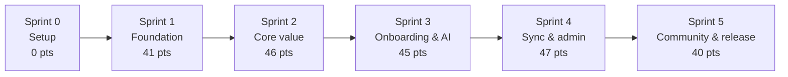

# Sprint Plan

Implementation plan for OpenSource-helper, from setup to release. Each sprint is a folder with one file for the work and separate files for API checks, testing and review, so a sprint can be covered and signed off without jumping around a large document.

## Folder structure

```
docs/Sprints/
├── README.md                 ← this file: roadmap, workflow, review dashboard
├── sprint0/                  ← setup (no product testing)
│   ├── 00-sprint.md          ← setup definition, decisions, tasks, DoD
│   └── 01-review.md          ← environment verification and sign-off
├── sprint1/
│   ├── 00-sprint.md          ← description, HLF, user stories, ACs, technical work, DoD
│   ├── 01-api.md             ← endpoint contract + manual API checklist
│   ├── 02-testing.md         ← coverage map, unit, integration, manual, NFR tests
│   └── 03-review.md          ← acceptance checklist, quality gates, demo, sign-off
├── sprint2/  (same four files)
├── sprint3/  (same four files)
├── sprint4/  (same four files)
└── sprint5/  (same four files)
```

## What each file is for

| File | Use it to |
|---|---|
| `00-sprint.md` | Understand the sprint: description, high-level FRs, scope, user stories with acceptance criteria, technical work and Definition of Done. |
| `01-api.md` | Define the endpoints for this sprint, then run the manual API checklist (happy path, auth, roles, validation). |
| `02-testing.md` | Cover every story with unit, integration, manual and non-functional tests. |
| `03-review.md` | Tick acceptance, quality gates and demo, then sign off the sprint. |

Sprint 0 has no API or testing file because no product feature is built in it. Its review file verifies the environment instead.

## Roadmap

| Sprint | Theme | Points | Main FRs |
|---|---|---|---|
| [0](sprint0/00-sprint.md) | Setup and project foundation | 0 (pre-sprint) | — |
| [1](sprint1/00-sprint.md) | Foundation: accounts, profiles, CV, settings | 41 / 50 | FR-1, FR-2, FR-3, FR-14 (partial), FR-20 (partial), FR-13 (partial) |
| [2](sprint2/00-sprint.md) | Core value: discovery, matching, selection | 46 / 50 | FR-4, FR-5, FR-6, FR-7 (partial), FR-20 (partial) |
| [3](sprint3/00-sprint.md) | Onboarding and AI guide | 45 / 50 | FR-8 (partial), FR-9, FR-10, FR-11 |
| [4](sprint4/00-sprint.md) | Sync, notifications, gamification, admin | 47 / 50 | FR-7 (partial), FR-8 (partial), FR-13, FR-14 (partial), FR-16, FR-19 |
| [5](sprint5/00-sprint.md) | Community, polish and release | 40 / 50 | FR-12, FR-15, FR-17, FR-18, FR-20 (partial) |

Total: 219 story points. Sprint 0 is a 3–5 day pre-sprint outside this total. The five official sprints are 2 weeks each with 50 points capacity.

## Review dashboard

Tick a column when the file is complete. This is the quickest way to see what is left across all sprints.

| Sprint | Spec | API | Tests | Review | Signed off |
|---|---|---|---|---|---|
| 0 | [00-sprint](sprint0/00-sprint.md) | — | — | [01-review](sprint0/01-review.md) | ☐ |
| 1 | [00-sprint](sprint1/00-sprint.md) | [01-api](sprint1/01-api.md) | [02-testing](sprint1/02-testing.md) | [03-review](sprint1/03-review.md) | ☐ |
| 2 | [00-sprint](sprint2/00-sprint.md) | [01-api](sprint2/01-api.md) | [02-testing](sprint2/02-testing.md) | [03-review](sprint2/03-review.md) | ☐ |
| 3 | [00-sprint](sprint3/00-sprint.md) | [01-api](sprint3/01-api.md) | [02-testing](sprint3/02-testing.md) | [03-review](sprint3/03-review.md) | ☐ |
| 4 | [00-sprint](sprint4/00-sprint.md) | [01-api](sprint4/01-api.md) | [02-testing](sprint4/02-testing.md) | [03-review](sprint4/03-review.md) | ☐ |
| 5 | [00-sprint](sprint5/00-sprint.md) | [01-api](sprint5/01-api.md) | [02-testing](sprint5/02-testing.md) | [03-review](sprint5/03-review.md) | ☐ |

## Workflow per sprint

1. **Read** `00-sprint.md`. Confirm scope, FRs, stories and acceptance criteria.
2. **Define** the endpoints in `01-api.md` before coding. Fill the contract table, then implement.
3. **Test** using `02-testing.md`: write unit and integration tests, run the manual cases, check the NFRs.
4. **Verify** the API manually using `01-api.md` and record the result.
5. **Review** with `03-review.md`: tick stories, quality gates and demo, then sign off.
6. **Move on** only when the review file is signed. Do not start the next sprint with open blockers.

## Dependencies



- Sprint 1 needs the auth, database, CI and app shell from Sprint 0.
- Sprint 2 needs completed profiles and AI settings from Sprint 1.
- Sprint 3 needs selected Issues from Sprint 2 and the AI guardrail baseline.
- Sprint 4 needs progress records from Sprint 3 and notification tables from Sprint 1.
- Sprint 5 needs badges and profiles from Sprint 4 for the public profile.

## Cross-sprint conventions

- **Traceability:** every task references an FR and a story ID (`US-<FR>.<n>`).
- **API first:** define the endpoint in `01-api.md` before writing the handler.
- **Testing:** unit tests for logic, integration tests for APIs/jobs, manual tests for user flows, NFR checks for performance/security/AI guardrails.
- **Definition of Done:** acceptance criteria pass, tests pass, API documented, code reviewed.
- **Branching:** one branch per story or small group, e.g. `feat/fr-4-issue-search`.
- **No scope creep:** anything outside the sprint scope goes to the backlog.

## Sources

- `../requirements/functional-requirements.md`
- `../requirements/non-functional-requirements.md`
- `../requirements/user-story.md`
- `../use-case/use-case-diagram.md`
- `../API.md`
- `../vibe-coding-report.md`
