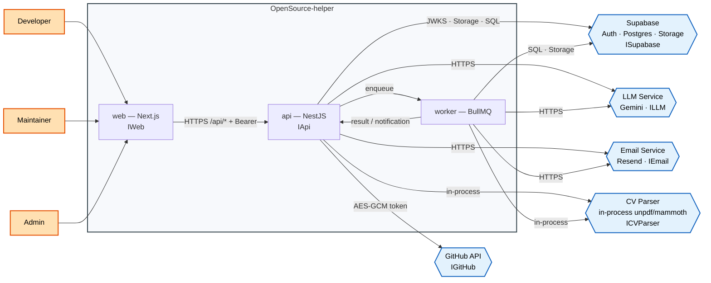

# 00 — System context (PM1 level 0)

Actors, the system box, provided interfaces, required interfaces and the five
runtime external systems. Every operation names the FR that uses it.

## Provided interfaces

### IWeb — provided by `web`

**High level:** Manage authentication · Manage developer information ·
Manage discovery and matching · Manage onboarding · Manage progress ·
Manage community.

**Low level (grouped by high level):**

| High level | Operation | Used by |
|---|---|---|
| Manage authentication | `/login`, `/signup`, `/forgot-password`, `/reset-password`, `/auth/callback` | FR-1.1–1.4 |
| Manage developer information | `/onboarding`, `/settings/profile`, CV dropzone | FR-2.1–2.4, FR-3.1–3.5 |
| Manage discovery and matching | `/discover` filters, three cards, regenerate | FR-4.1–4.4, FR-5.1–5.5 |
| Manage selection and progress | `/issues/[id]`, `/progress`, status dialog | FR-6.1–6.5, FR-8.1–8.4 |
| Manage onboarding | Overview, AI guide tab | FR-9.1–9.4, FR-10.1–10.4, FR-11.1–11.5 |
| Manage saved items | `/saved` lists and items | FR-7.1–7.4 |
| Manage notifications | `/notifications`, preferences | FR-13.1–13.5 |
| Manage community | `/community`, contributor detail, `/requests` | FR-17.1–17.5, FR-18.1–18.4 |
| Manage public profile | `/u/[handle]`, achievements visibility | FR-15.1–15.5, FR-16.1–16.4 |
| Manage admin | `/admin`, `/admin/ai` | FR-19.1–19.6, FR-20.1–20.4 |

### IApi — provided by `api`

**High level:** IAccount · ISkillProfile · IIssueSearch · IContributionTracking
· IOnboarding · IAIGuide · INotification · ICommunity · IMentorNetwork ·
IAdminDashboard · IAISettings.

**Low level:** see `docs/API.md`, the sprint contracts and the 20 feature
documents. Each API operation is authorised by a global guard, a role gate and
a service-level ownership check.

## Required interfaces

### IGitHub — GitHub API

**High level:** Search issues · read repositories · read pull requests ·
read public contributor data · connect the account.

**Low level:**

| Operation | Used by |
|---|---|
| `search/issues` open/unassigned pool | FR-4.1–4.10, FR-5.1–5.11 |
| issue + comments + README/tree | FR-9.1–9.9, FR-10.1–10.9, FR-11.6 |
| pull request state / issue timeline | FR-8.6–8.7 |
| issue state for saved items | FR-7.7–7.8 |
| contributors, participation, user profile | FR-17.1–17.10 |
| `GET /user` on connect | FR-1.5, FR-1.10 |

Cache: shared pool 15 min + 24 h stale; repo context 15 min; contributor data
15 min. Rate limit: 429/stale cache, never a blank screen.

### ISupabase — Supabase

**High level:** Authenticate users · store durable state · store CVs.

**Low level:**

| Operation | Used by |
|---|---|
| Auth token issue + JWKS | FR-1.1–1.2, every protected operation |
| Postgres via Prisma | FR-1–FR-20 |
| private Storage object upload/download | FR-3.1–3.11 |
| admin user deletion | FR-14.11 |

### IEmail — Resend

**High level:** Send transactional email.

**Low level:**

| Operation | Used by |
|---|---|
| password reset (Supabase-managed) | FR-1.4, FR-1.9 |
| notification + digest email | FR-13.8 |
| outreach notification email (optional) | FR-18.5 |

Email is best-effort; in-app is the source of truth.

### ILLM — Gemini

**High level:** Extract · rank · explain.

**Low level:**

| Operation | Used by |
|---|---|
| CV JSON extraction | FR-3.8 |
| rank ≤20 candidates + reason | FR-5.6–5.9 |
| repository + issue onboarding JSON | FR-9.5–9.8, FR-10.5–10.8 |
| guide answer | FR-11.6–11.8 |

Every call is metered before and after; a provider failure falls back to rules
for ranking/onboarding and refuses cleanly for the guide.

### ICVParser — in-process document parser

**High level:** Extract plain text from PDF/DOCX.

**Low level:**

| Operation | Used by |
|---|---|
| `unpdf.extractText` | FR-3.7 |
| `mammoth.extractRawText` | FR-3.7 |

Recorded as an in-process dependency in ADR 0004, not a third-party runtime
service.

## Runtime external systems

Exactly five: GitHub API, Supabase, Email Service, CV Parser (in-process), LLM
Service. Jira is PM1-only and is never called by the application.

## Used-by traceability

Every box and operation above maps to code in
[`05-traceability.md`](05-traceability.md). Use cases are in
`docs/use-case/use-case-diagram.md`.
