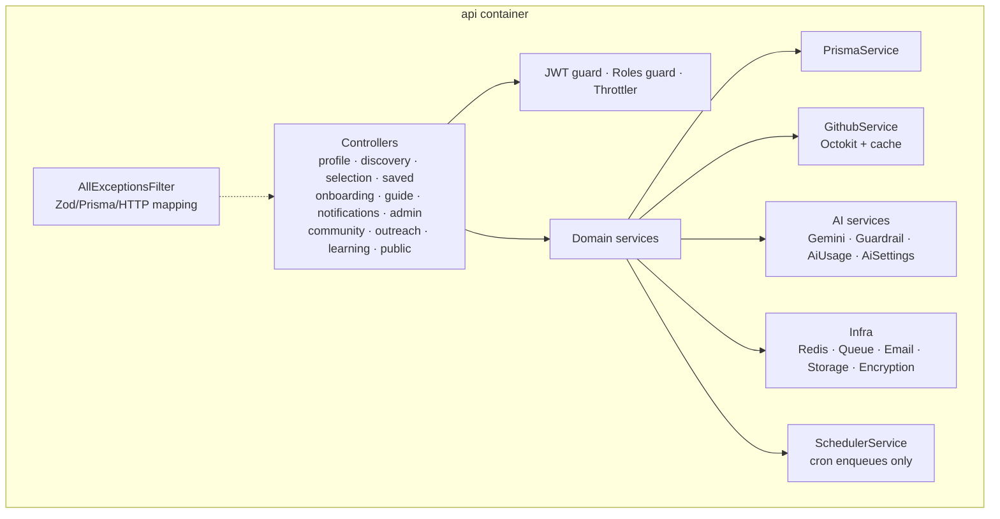

# 02 — Components: API (PM1 level 2)

## Provided interfaces

`IAccount`, `ISkillProfile`, `IIssueSearch`, `IContributionTracking`,
`IOnboarding`, `IAIGuide`, `INotification`, `ICommunity`, `IMentorNetwork`,
`IAdminDashboard`, `IAISettings`. Operation names are the REST paths in
`docs/API.md`.

## Required interfaces

GitHub (`GithubService`), Supabase Auth/JWKS (`SupabaseJwtService`), Supabase
Storage (`StorageService`), Gemini (`GeminiService`), email (`EmailService`),
Redis (`RedisService`, `QueueService`). The CV parser is in-process.

## Modules and files

| Module | Responsibility | Files |
|---|---|---|
| Auth | verify JWKS, resolve/upsert user, roles | `src/auth/*` |
| Profile | me, profile, completeness, history, deletion request | `src/modules/profile/*` |
| CV | validate, store, enqueue, extract, status | `src/modules/cv/*` |
| Github | connect/token, search, repo context, PRs, contributors | `src/modules/github/*` |
| Discovery | search, rank, regenerate, details | `src/modules/discovery/*` |
| Selection | select, ignore, progress, history | `src/modules/selection/*` |
| Saved | lists and items | `src/modules/saved/*` |
| Onboarding | repository + issue content, cache | `src/modules/onboarding/*` |
| Guide | conversation, context, refusal, history | `src/modules/guide/*` |
| Notifications | create/list/read/preferences/delivery | `src/modules/notifications/*` |
| Achievements | badges, streaks, visibility | `src/modules/achievements/*` |
| Public profile | settings, publish, public read | `src/modules/public-profile/*` |
| Community | contributor search/detail | `src/modules/community/*` |
| Outreach | requests, responses, messages, blocks | `src/modules/outreach/*` |
| Learning | seeded guide search | `src/modules/learning/*` |
| Admin | metrics, users, AI usage/settings | `src/modules/admin/*` |
| AI | Gemini adapter, guardrail, metering, settings | `src/modules/ai/*` |
| Infra | Redis, queue, email, storage, encryption | `src/infra/*` |
| Jobs | cron enqueue, sync, worker runner | `src/jobs/*` |
| Health | liveness and readiness | `src/health.controller.ts` |

## Error contract

`AllExceptionsFilter` maps Zod → 400 `VALIDATION_ERROR`, Prisma P2002 → 409,
P2025 → 404, `AppError` → its code, unknown → 500 without a stack in the body.
Every response carries `x-request-id`; logs never contain a token or query
string with credentials.
