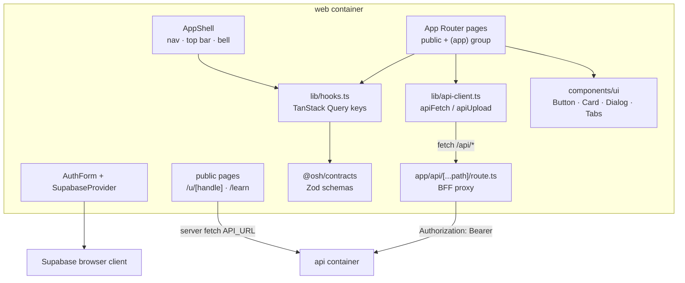

# 02 — Components: web (PM1 level 2)

## Provided interface

`IWeb` — pages, forms and navigation listed in
[`00-context.md`](00-context.md). Public pages render without auth and without
client JavaScript for the first paint.

## Required interfaces

- `IApi` via the BFF for authenticated client calls, and `API_URL` server-side
  for public pages.
- Supabase Auth for the session cookie and OAuth callback.
- `@osh/contracts` for request/response shapes (no duplicated enums).
- No Prisma, no Gemini, no GitHub token, no service role key.

## Component map

| Component | File | Responsibility |
|---|---|---|
| Home + hero | `app/page.tsx`, `components/hero-window.tsx` | one CTA, 15s product story, reduced-motion fallback |
| Sign-in popover | `components/sign-in-popover.tsx` | hover/keyboard/touch entry; email + GitHub |
| Auth pages | `components/auth-form.tsx`, `app/login|signup|forgot-password|reset-password` | session creation and recovery |
| Onboarding | `app/onboarding/page.tsx`, `components/cv-upload.tsx`, `components/tag-input.tsx` | three steps, autosave, CV review |
| Discover | `app/(app)/discover/page.tsx`, `components/recommendation-card.tsx` | filters, three cards, reasons, save/ignore, fallback label |
| Issue detail | `components/issue-detail.tsx`, `components/prose.tsx` | tabs, onboarding, selection, progress |
| Guide | `components/guide-chat.tsx` | refusal panel, history, token meter, limit state |
| Progress | `app/(app)/progress/page.tsx` | three columns, manual update, sync now |
| Saved / notifications / achievements | matching `app/(app)/*` pages | lists, read state, badges, public settings |
| Community / requests | `app/(app)/community/*`, `app/(app)/requests/page.tsx` | ranked contributors, outreach, conversation |
| Admin | `app/(app)/admin/*` | metrics, AI usage, settings vs limit |
| Public profile + OG | `app/u/[handle]/page.tsx`, `opengraph-image.tsx` | opt-in sections, shareable link |
| Learning | `app/learn/*` | static guides and topic search |
| BFF | `app/api/[...path]/route.ts` | attach token, forward method/body/query, no business logic |

## Failure behaviour

- API unreachable → JSON `503 API_UNAVAILABLE`, the page shows a retry message.
- 401 → middleware redirects to `/login?next=…`.
- 403 → admin pages show the calm "You don't have access" state.
- 429 AI limit → composer disabled with the reset date.
- Public profile 404 → "This profile is private.", no data leak.
