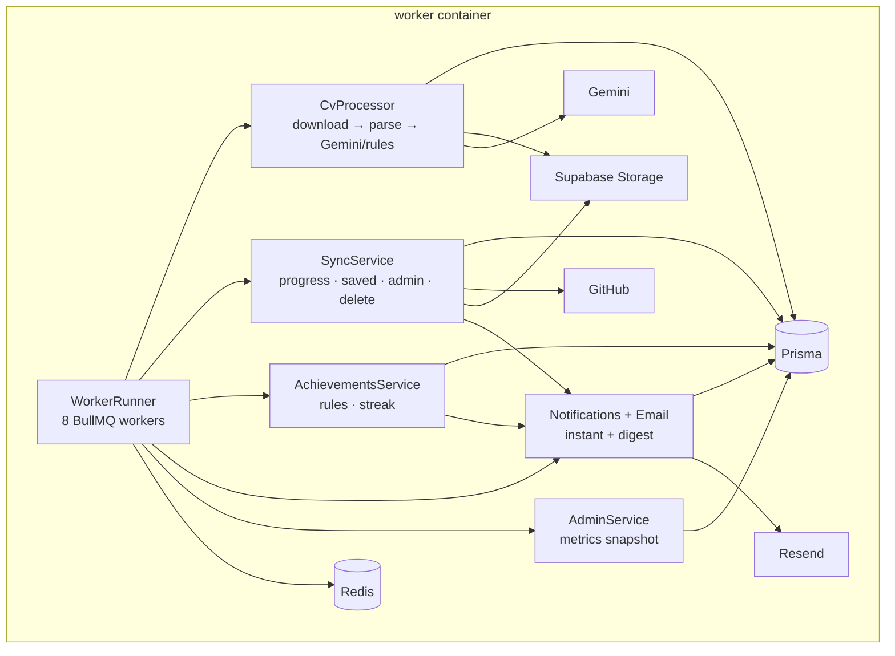

# 02 — Components: worker (PM1 level 2)

## Queues and idempotency

| Queue | Trigger | Key | Retries |
|---|---|---|---|
| `cv.extract` | upload | `cv:<fileId>` | 3, exponential |
| `notifications.deliver` | notification create | `notification:<id>:email` | 3 |
| `notifications.digest` | 08:00 cron | `digest:<user>:<date>` | 3 |
| `github.sync.progress` | 5 min cron / Sync now | `sync-progress:<window>` | 3 |
| `github.sync.saved` | 15 min cron | `sync-saved:<window>` | 3 |
| `gamification.evaluate` | after merge | `badge:<user>:<selection>` | 3 |
| `admin.aggregate` | 5 min cron | `admin-aggregate:<window>` | 3 |
| `account.delete` | deletion request | `delete:<requestId>` | 3 |

## Provided interface

`IWorker` — background execution of the six job families above. It writes
durable rows; it never serves an HTTP request.

## Required interfaces

Postgres (same schema as the API — ADR 0003), Redis, GitHub, Gemini, Supabase
Storage, Resend.

## Failure behaviour

- A failed job retries three times, then stays in the dead-letter set.
- The same GitHub event cannot duplicate a history row, badge or notification:
  `ProgressEvent.dedupeKey`, `Notification.(userId,dedupeKey)` and
  `UserBadge.(userId,badgeId)` are unique.
- CV failure stores `FAILED` + a short reason; the UI offers retry.
- No GitHub login → no auto-PR attribution; manual status still works.
