# 03 — Class diagram: API (PM1 level 3, after SOLID)

Classes follow the Nest module boundary. Controllers translate HTTP; services
own rules; adapters hide externals. Dependencies point inward: a service never
imports a controller, and no class reaches into another module's tables
directly without a service.

```mermaid
classDiagram
  class PrismaService {
    +onModuleInit()
    +onModuleDestroy()
  }
  class JwtAuthGuard {
    +canActivate(ctx)
  }
  class RolesGuard {
    +canActivate(ctx)
  }
  class AuthService {
    +resolveUser(claims) RequestUser
    +findDevUser(email)
  }
  class SupabaseJwtService {
    +verify(token) SupabaseClaims
  }
  class ProfileService {
    +me(userId) Me
    +updateMe(userId, input)
    +profile(userId) Profile
    +updateProfile(userId, input)
    +requireComplete(userId)
    +history(userId)
    +requestDeletion(userId)
  }
  class CvService {
    +upload(userId, file)
    +latest(userId)
    +retry(userId, id)
    +process(fileId)
  }
  class GithubService {
    +status(userId)
    +connect(userId, token)
    +searchIssues(userId, filters)
    +issueDetails(userId, id)
    +repoContext(userId, repo)
    +pullStatus(userId, url)
    +findLinkedPullRequest(...)
    +searchContributors(userId, input)
    +contributorDetail(userId, login)
  }
  class DiscoveryService {
    +search(userId, filters)
    +recommend(userId, input, regenerate)
    +latest(userId)
    +issue(userId, id)
  }
  class SelectionService {
    +select(userId, input)
    +ignore(userId, issueId)
    +progress(userId)
    +history(userId, selectionId)
    +update(userId, id, input)
  }
  class SavedService {
    +lists(userId)
    +createList(userId, input)
    +detail(userId, id)
    +add(userId, input)
    +move(userId, itemId, listId)
    +select(userId, itemId)
  }
  class OnboardingService {
    +repository(userId, issueId)
    +issueOnboarding(userId, issueId)
  }
  class GuideService {
    +conversation(userId, issueId)
    +send(userId, issueId, content)
  }
  class GuardrailService {
    +asksForSolution(text) bool
    +isCodeFree(text) bool
    +stripCode(text)
    +finalize(raw, opts)
    +sanitizeField(raw)
  }
  class AiUsageService {
    +assertAllowed(userId, feature, estimate)
    +record(input)
    +summary(start, end, feature)
  }
  class GeminiService {
    +generateJson(input)
    +generateText(input)
  }
  class RedisService {
    +getJson(key)
    +setJson(key, value, ttl)
    +increment(key, ttl)
  }
  class QueueService {
    +add(queue, data, key)
    +addOrFail(queue, data, key)
  }
  class EncryptionService {
    +encrypt(plain) string
    +decrypt(payload) string
  }
  class NotificationsService {
    +create(input)
    +list(userId)
    +markRead(userId, id)
    +preferences(userId)
    +updatePreferences(userId, input)
  }
  class SyncService {
    +syncProgress()
    +syncSaved()
    +aggregateAdmin()
    +deliverNotification(id)
    +deleteAccount(requestId)
  }
  class AdminService {
    +metrics(from, to)
    +users()
    +usage(start, end, feature)
    +settingsAgainstUsage()
  }

  JwtAuthGuard --> SupabaseJwtService
  JwtAuthGuard --> AuthService
  RolesGuard --> PrismaService
  AuthService --> PrismaService
  ProfileService --> PrismaService
  CvService --> PrismaService
  CvService --> QueueService
  CvService --> GeminiService
  CvService --> GuardrailService
  GithubService --> PrismaService
  GithubService --> RedisService
  GithubService --> EncryptionService
  DiscoveryService --> ProfileService
  DiscoveryService --> GithubService
  DiscoveryService --> GeminiService
  DiscoveryService --> AiUsageService
  DiscoveryService --> NotificationsService
  SelectionService --> PrismaService
  SelectionService --> NotificationsService
  SavedService --> SelectionService
  OnboardingService --> GithubService
  OnboardingService --> GeminiService
  OnboardingService --> AiUsageService
  GuideService --> GeminiService
  GuideService --> GuardrailService
  GuideService --> AiUsageService
  AiUsageService --> PrismaService
  QueueService --> RedisService
  NotificationsService --> QueueService
  SyncService --> GithubService
  SyncService --> NotificationsService
  AdminService --> AiUsageService
  AdminService --> RedisService
```

## SOLID notes

- **Single responsibility:** the guard authenticates, the roles guard authorises,
  the service owns the rule, the adapter owns the external protocol.
- **Open/closed:** new AI features add a `AiFeature` and a prompt; they reuse
  `assertAllowed`/`record` rather than touching each service's meter.
- **Liskov:** `AppError` subclasses replace `HttpException` without changing the
  filter contract.
- **Interface segregation:** each module exports only the service another module
  needs (`ProfileService`, `GithubService`, `NotificationsService`).
- **Dependency inversion:** services depend on `PrismaService`, `RedisService`,
  `GeminiService`, `GithubService`; tests can substitute them.

## Traceability

| Class | File |
|---|---|
| Guards | `apps/api/src/auth/jwt-auth.guard.ts`, `roles.guard.ts` |
| Profile, CV | `src/modules/profile/profile.service.ts`, `src/modules/cv/cv.service.ts` |
| Discovery, Selection, Saved | `src/modules/discovery`, `selection`, `saved` |
| Onboarding, Guide | `src/modules/onboarding`, `guide` |
| AI | `src/modules/ai/*` |
| Infra | `src/infra/*` |
| Jobs | `src/jobs/sync.service.ts` |
