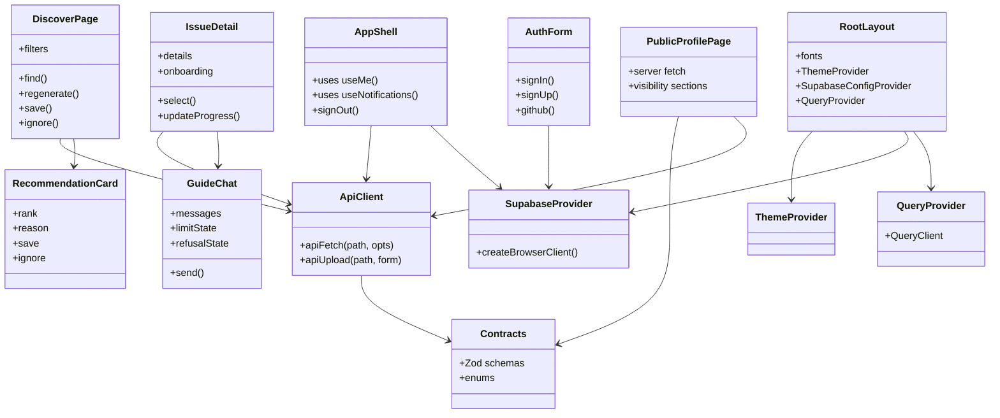

# 03 — Class diagram: web (PM1 level 3)

## SOLID notes

- Pages compose feature components; they do not call the database or a provider.
- `ApiClient` is the single transport; every response is the contract type.
- `SupabaseProvider` is the only place a browser Supabase client is constructed.
- Public pages use a server-side `publicApi` and keep their rendering independent
  of auth.

## Traceability

| Class | File |
|---|---|
| Root layout | `apps/web/app/layout.tsx` |
| App shell | `components/app-shell.tsx` |
| Auth | `components/auth-form.tsx`, `components/sign-in-popover.tsx` |
| Discover | `app/(app)/discover/page.tsx`, `components/recommendation-card.tsx` |
| Issue | `components/issue-detail.tsx`, `components/guide-chat.tsx` |
| API client | `lib/api-client.ts` |
| Providers | `components/supabase-provider.tsx`, `query-provider.tsx`, `theme-provider.tsx` |
| Public profile | `app/u/[handle]/page.tsx` |
