# 04 — ERD (Prisma, one data owner)

The API and worker share this database; they are one service with two processes
(ADR 0003). `apps/api/prisma/schema.prisma` is the source of truth and the
migration `20261026232106_init` created it.

```mermaid
erDiagram
  User ||--o| DeveloperProfile : has
  User ||--o{ UserSkill : has
  Skill ||--o{ UserSkill : used_by
  User ||--o{ UserLanguage : has
  Language ||--o{ UserLanguage : used_by
  User ||--o{ CvFile : uploads
  User ||--o{ AiUsage : consumes
  User ||--o{ SuggestionEvent : receives
  User ||--o{ Recommendation : receives
  User ||--o{ Selection : selects
  User ||--o{ IgnoredIssue : ignores
  User ||--o{ SavedList : owns
  SavedList ||--o{ SavedItem : contains
  User ||--o{ ChatConversation : opens
  ChatConversation ||--o{ ChatMessage : contains
  User ||--o{ Notification : receives
  User ||--o| NotificationPreference : sets
  User ||--o{ UserBadge : earns
  Badge ||--o{ UserBadge : awarded
  User ||--o| Streak : has
  User ||--o| PublicProfile : publishes
  User ||--o{ OutreachRequest : sends
  User ||--o{ OutreachRequest : receives
  OutreachRequest ||--o| OutreachConversation : opens
  OutreachConversation ||--o{ OutreachMessage : contains
  User ||--o{ BlockedUser : blocks
  User ||--o{ DeletionRequest : requests
  GithubIssue ||--o{ Recommendation : ranked_as
  GithubIssue ||--o{ SuggestionEvent : suggested
  GithubIssue ||--o{ Selection : selected
  GithubIssue ||--o{ IgnoredIssue : ignored
  GithubIssue ||--o{ SavedItem : saved
  GithubIssue ||--o| IssueOnboarding : explains
  Selection ||--o{ ProgressEvent : history
  RepositoryOnboarding }o--|| GithubIssue : repository

  User {
    string id PK
    string authId UK
    string email UK
    string username UK
    enum role
    string githubLogin
    string githubTokenEnc
    datetime lastSeenAt
  }
  DeveloperProfile {
    string userId UK
    string description
    enum experienceLevel
  }
  CvFile {
    string id PK
    string userId FK
    string storagePath
    enum status
    json extracted
  }
  AiSetting {
    string id PK
    int maxTokensPerUser
    float temperature
    float usageLimitUsd
  }
  AiUsage {
    string id PK
    string userId FK
    enum feature
    int totalTokens
    float costUsd
  }
  GithubIssue {
    string id PK
    string repoFullName
    int number
    string[] labels
    enum level
    datetime activityAt
  }
  Recommendation {
    string id PK
    string batchId
    int rank
    string reason
    boolean fallback
  }
  Selection {
    string id PK
    string userId FK
    string issueId FK
    enum status
    string prUrl
    datetime lastSyncedAt
  }
  ProgressEvent {
    string id PK
    string selectionId FK
    enum status
    enum source
    string dedupeKey UK
  }
  Notification {
    string id PK
    string userId FK
    enum type
    string dedupeKey
    datetime readAt
    datetime emailedAt
  }
  PublicProfile {
    string userId UK
    string handle UK
    boolean published
    boolean mentorOptIn
  }
  OutreachRequest {
    string id PK
    string senderId FK
    string recipientId FK
    enum status
  }
```

## Data ownership

| Domain | Tables | Owner |
|---|---|---|
| Identity and profile | `User`, `DeveloperProfile`, `Skill`, `UserSkill`, `Language`, `UserLanguage` | `profile` module |
| CV | `CvFile` | `cv` module |
| AI | `AiSetting`, `AiUsage`, `AiUsageDaily` | `ai` module |
| Discovery | `GithubIssue`, `Recommendation`, `SuggestionEvent` | `discovery` module |
| Contribution tracking | `Selection`, `ProgressEvent`, `IgnoredIssue`, `SavedList`, `SavedItem` | `selection`, `saved` |
| Onboarding | `RepositoryOnboarding`, `IssueOnboarding` | `onboarding` module |
| Guide | `ChatConversation`, `ChatMessage` | `guide` module |
| Notifications | `Notification`, `NotificationPreference` | `notifications` module |
| Community | `PublicProfile`, `Badge`, `UserBadge`, `Streak`, `OutreachRequest`, `OutreachConversation`, `OutreachMessage`, `BlockedUser` | community modules |
| Operations | `AdminSnapshot`, `JobRun`, `SyncState`, `DeletionRequest` | jobs/admin |

## Migration history

| Migration | Applied | Notes |
|---|---|---|
| `20261026232106_init` | local `osh`, `osh_test` | additive initial schema; never edited |

`docs/engineering/data-model.md` links the ERD and the RLS policy file.
