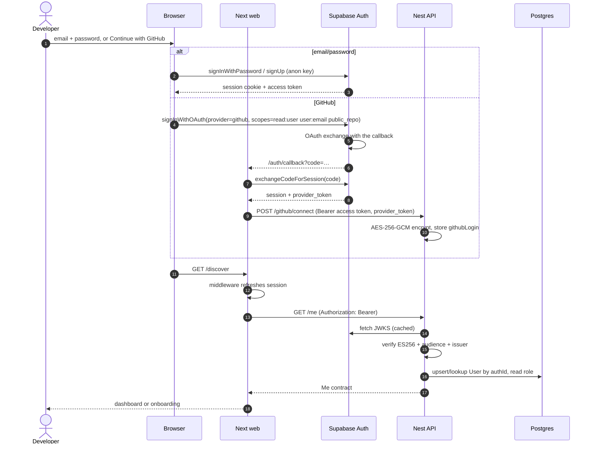

# Sequence — sign-up and login

Failure: invalid/expired token → 401; the middleware redirects to
`/login?next=…`. A GitHub callback without `code` shows the inline OAuth error.
No secret is ever logged. See FR-1 and ADR 0002.
