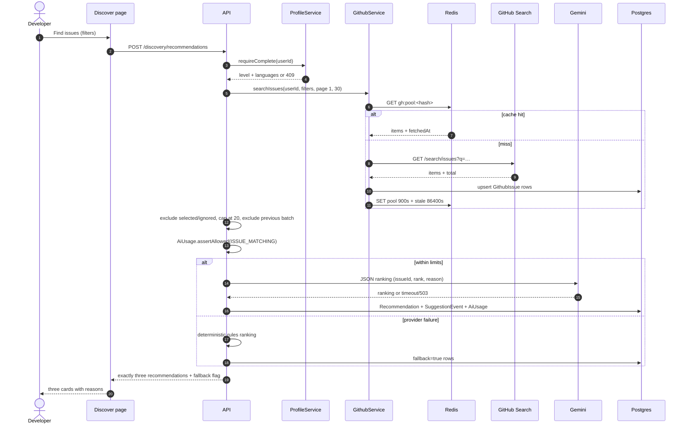

# Sequence — discovery and ranking

Cache TTL 15 minutes; stale 24 hours. A GitHub 429 returns the stale pool with
`stale=true` and a reset time. A model failure still returns three issues,
labelled `Ranked by rules`. See FR-4 and FR-5.
