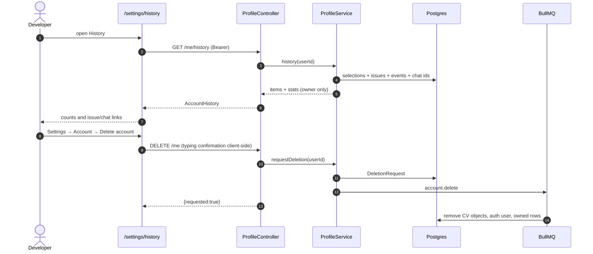

# Sequence — account history, statistics and deletion

The HTTP request only records the request; the worker performs the destructive
work. See FR-14 and `07-notifications.md` for the delivery side.
