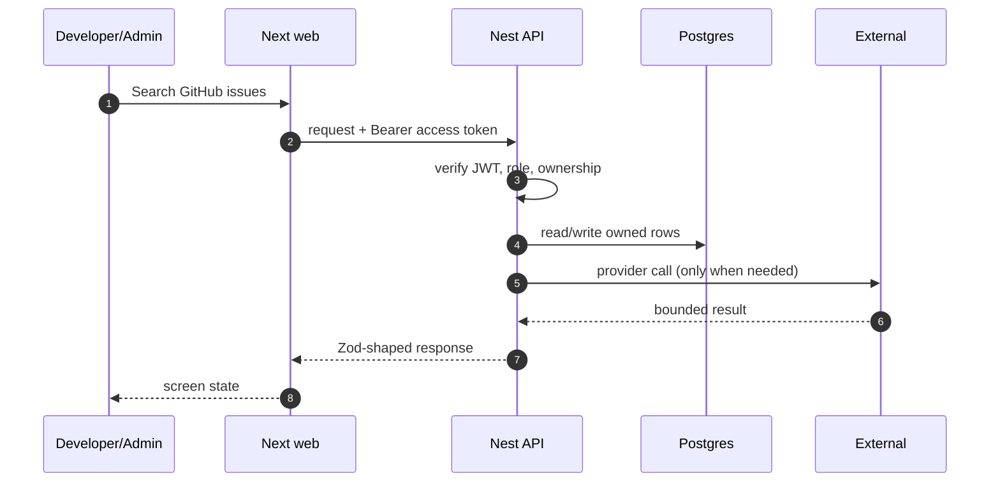

# FR-04 — Issue discovery

> Story: US-4.1, US-4.2, US-4.3, US-4.4 · Sprint: 2 · Slice: 3 · Status: shipped
> Last updated: 2026-10-27

## 1. What it does (user view)

A developer searches open GitHub issues by language, label, activity and organization/repository. Closed, assigned, inactive, selected and ignored issues are removed.

## 2. Why it exists (FR + acceptance criteria)

FR-4.1–4.10. Acceptance: results respect the filters; excluded issues never appear; empty results offer broader filters; the pool is passed to matching.

## 3. Where it lives

`app/(app)/discover/page.tsx`, `apps/api/src/modules/discovery/discovery.service.ts`, `apps/api/src/modules/github/github.service.ts`, `packages/contracts/src/discovery.ts`

## 4. How it works

1. The UI sends `GET /discovery/issues` with filters.
2. The API builds a GitHub search query (`is:issue is:open no:assignee ...`).
3. A shared Redis pool is keyed by query+page with a 15-minute TTL and a 24-hour stale copy.
4. Each item is upserted into `GithubIssue`; the user's selected/ignored ids are removed.
5. Rate limits return cached results with `stale=true` and a reset time.

## 5. Sequence diagram

## 6. Data

`GithubIssue` (id `owner/repo#number`, labels, language, level, activityAt, stars), `IgnoredIssue`, `Selection`. Indexes on language/state/activity, repository and organization.

## 7. Contract

`GET /discovery/issues` (Developer). Errors: 400 invalid filter, 429 `GITHUB_RATE_LIMITED`, 503 `GITHUB_UNAVAILABLE`.

## 8. External calls, quota and fallback

GitHub Search API (~30 req/min authenticated; lower unauthenticated). Cache is shared across users; no search per user per keystroke. Fallback: stale cache, then an honest rate-limit message.

## 9. Authorization and failure modes

Role gate Developer; exclusions are per user. The candidate pool is shared but never leaks another user's selections.

## 10. Decisions and rejected alternatives

Shared candidate pool instead of per-user search; unauthenticated public search is allowed when GitHub is not connected.

## 11. Tests and evidence

Live run returned open TypeScript `good first issue` candidates; contract rejects `repo=not-a-repo`.

Evidence lives under `dev/evidence/slice-3/`. The PR body records the
exact commands and result.

## 12. Manual demo

Discover → language TypeScript → label good first issue → activity 180 days → Find issues.

## 13. Known limits and what would break it

GitHub search quality and quota are external. Archived repositories are excluded in the query; private repositories require a connected token with access.

## 14. Changelog

- 2026-10-27 — implemented and documented in the vertical build.
