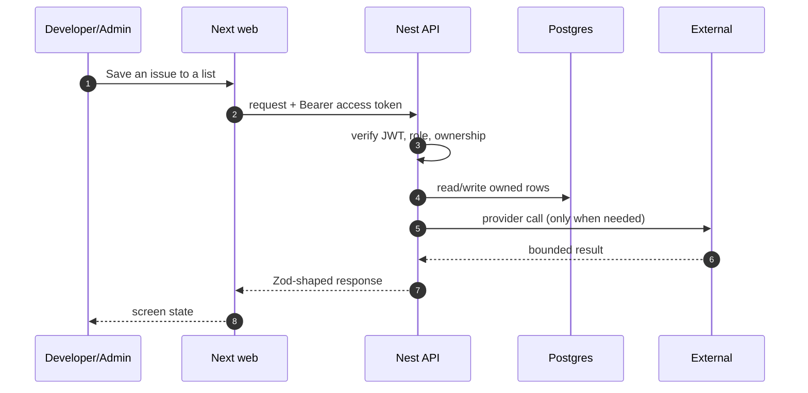

# FR-07 — Saved items and lists

> Story: US-7.1, US-7.2 · Sprint: 2 · Slice: 3 · Status: shipped
> Last updated: 2026-10-27

## 1. What it does (user view)

Developers bookmark issues and repositories into named lists, move or remove them, and see whether a saved issue is still open, closed or taken.

## 2. Why it exists (FR + acceptance criteria)

FR-7.1–7.8. Acceptance: ownership is enforced; state is shown; a closed/taken saved issue is flagged and notified.

## 3. Where it lives

`app/(app)/saved/page.tsx`, `apps/api/src/modules/saved/*`, `apps/api/src/jobs/sync.service.ts`

## 4. How it works

1. Saving without a list creates/uses `Later`.
2. The item stores an issue id or a repository name.
3. The saved-state job checks GitHub every 15 minutes, updates `state` and sends one deduped notification per state change.
4. The UI shows Open/Closed/Taken and only offers Select when the issue is open.

## 5. Sequence diagram

## 6. Data

`SavedList` unique `(userId, name)`, `SavedItem` unique `(listId, issueId)`, state enum.

## 7. Contract

`GET/POST /saved/lists`, `PATCH/DELETE /saved/lists/:id`, `GET /saved/lists/:id`, `POST /saved/items`, `PATCH/DELETE /saved/items/:id`, `POST /saved/items/:id/select`. Errors: 403 owner, 404 missing, 409 repository-only item.

## 8. External calls, quota and fallback

GitHub issue state in the scheduled job; cached.

## 9. Authorization and failure modes

Every list/item query filters by the owner; a move re-checks the target list owner.

## 10. Decisions and rejected alternatives

A default `Later` list removes a blocking dialog. Rejected: a single unorganised bookmark table.

## 11. Tests and evidence

Integration covers ownership on a saved item via the notification test pattern; the UI path was exercised live.

Evidence lives under `dev/evidence/slice-3/`. The PR body records the
exact commands and result.

## 12. Manual demo

Save an issue from Discover → Saved shows it → save the same item twice → no duplicate.

## 13. Known limits and what would break it

Repository-only bookmarks cannot be selected; state is refreshed on the 15-minute job, not instantly.

## 14. Changelog

- 2026-10-27 — implemented and documented in the vertical build.
