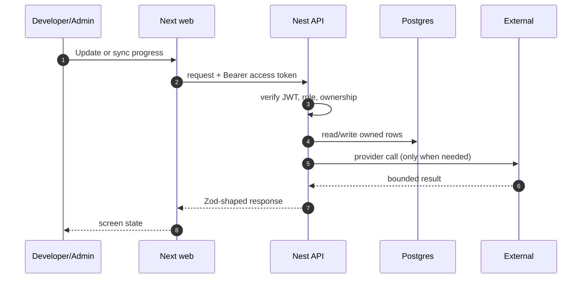

# FR-08 — Progress, PR link and sync

> Story: US-8.1, US-8.2, US-8.3 · Sprint: 3 · Slice: 4 · Status: shipped
> Last updated: 2026-10-27

## 1. What it does (user view)

A dashboard shows selected issues in In Progress, PR Open and Merged, with counts, elapsed time, a manual update dialog and an attached PR link. A scheduled job syncs from GitHub.

## 2. Why it exists (FR + acceptance criteria)

FR-8.1–8.10. Acceptance: status changes within 5 minutes of a PR/merge; history is dated; counts and time since selection are correct; Admin and gamification receive the data.

## 3. Where it lives

`app/(app)/progress/page.tsx`, `components/issue-detail.tsx` (Progress tab), `apps/api/src/modules/selection/*`, `apps/api/src/jobs/sync.service.ts`, `apps/api/src/jobs/scheduler.service.ts`

## 4. How it works

1. The UI reads `GET /progress`.
2. Manual update posts a status and optional GitHub PR URL; the service rejects backward moves from Merged.
3. Every change writes a `ProgressEvent` with source manual/sync.
4. The API cron enqueues `github.sync.progress` every 5 minutes; the worker checks the attached PR or the user's linked PR, updates status and writes a deduped event.
5. Merged enqueues gamification and a notification.

## 5. Sequence diagram

## 6. Data

`Selection.status/prUrl/lastSyncedAt`, `ProgressEvent` with `dedupeKey` unique, `SyncState`.

## 7. Contract

`GET /progress`, `POST /progress/sync`, `GET /progress/:id/history`, `PATCH /progress/:id`. Errors: 400 invalid status/PR URL, 403 not owner (404), 409 merged cannot move back.

## 8. External calls, quota and fallback

GitHub API. Auto-PR detection requires `githubLogin`; without it the app never attributes a stranger's PR. Cache/ETag on repo metadata; retries 3.

## 9. Authorization and failure modes

History is owner-only; the integration test asserts another user's selection returns 404.

## 10. Decisions and rejected alternatives

No drag-and-drop; GitHub is the source of truth. Polling is the fallback, webhooks are not required.

## 11. Tests and evidence

Integration asserts history ownership; live manual update path works. The false PR attribution bug was fixed and logged.

Evidence lives under `dev/evidence/slice-4/`. The PR body records the
exact commands and result.

## 12. Manual demo

Select an issue → Progress → Update status to PR Open and paste a PR URL → reload; then run `Sync now`.

## 13. Known limits and what would break it

A free GitHub account with no connected login cannot auto-sync; the demo uses the manual path. Closed unmerged PRs move back to In Progress with a note.

## 14. Changelog

- 2026-10-27 — implemented and documented in the vertical build.
