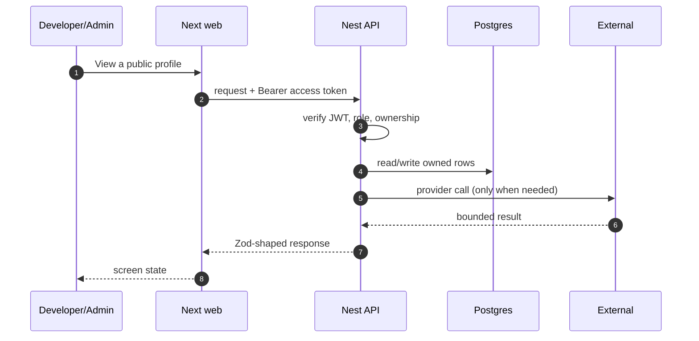

# FR-15 — Public contribution profile

> Story: US-15.1, US-15.2, US-15.3 · Sprint: 5 · Slice: 6 · Status: shipped
> Last updated: 2026-10-27

## 1. What it does (user view)

An opt-in public page at `/u/<handle>` with a unique link, visibility switches for skills, contributions, badges and streak, and mentor discoverability.

## 2. Why it exists (FR + acceptance criteria)

FR-15.1–15.10. Acceptance: unique shareable link; private means hidden; only chosen sections appear; mentor listing only when opted in.

## 3. Where it lives

`app/u/[handle]/page.tsx`, `app/u/[handle]/opengraph-image.tsx`, `apps/api/src/modules/public-profile/*`, `packages/contracts/src/community.ts`

## 4. How it works

1. `GET /public-profile/settings` creates a private profile with a derived unique handle.
2. `PUT` saves handle/visibility/published/mentor opt-in.
3. `GET /public/profiles/:handle` is public and only returns a published profile.
4. Sections are omitted (not greyed) when hidden; stats are zeroed for hidden sections.
5. The OG image is generated from the same public payload.

## 5. Sequence diagram

## 6. Data

`PublicProfile` unique handle, published, mentorOptIn, four visibility flags; `Selection` merged rows; `UserBadge` publicVisible; `Streak`.

## 7. Contract

`GET/PUT /public-profile/settings`, `POST /public-profile/publish`, `GET /public/profiles/:handle` (public). Errors: 404 private/unknown, 409 handle taken.

## 8. External calls, quota and fallback

None at read time; optional GitHub link is public data.

## 9. Authorization and failure modes

The public endpoint is explicitly `@Public()` and returns 404 for private; ownership re-checked on updates.

## 10. Decisions and rejected alternatives

Opt-in by default, privacy by omission. Rejected: public-by-default and greyed-out hidden sections.

## 11. Tests and evidence

Live `/u/sam` 200 and private-profile 404 path; OG image route builds.

Evidence lives under `dev/evidence/slice-6/`. The PR body records the
exact commands and result.

## 12. Manual demo

Achievements → Public profile → set handle, publish, enable skills → open `/u/<handle>` in a private window.

## 13. Known limits and what would break it

Contribution stats are from this platform, not GitHub's full history. OG images use the default font (no custom font fetch).

## 14. Changelog

- 2026-10-27 — implemented and documented in the vertical build.
