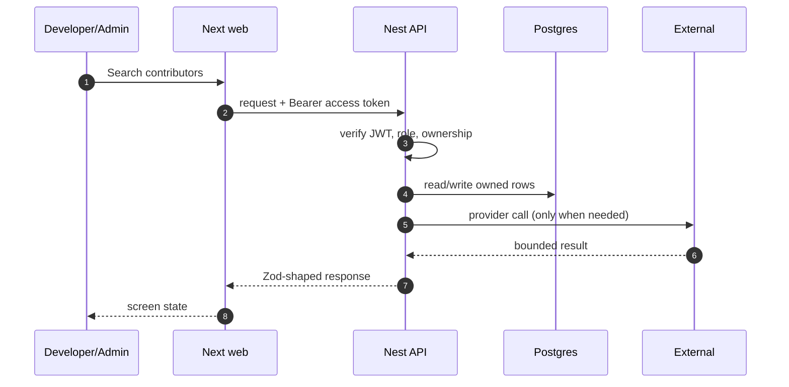

# FR-17 — Contributor search

> Story: US-17.1, US-17.2, US-17.3 · Sprint: 5 · Slice: 6 · Status: shipped
> Last updated: 2026-10-27

## 1. What it does (user view)

Search public contributors of an organization or repository, filter by language/topic, rank by activity, and open activity, expertise and a platform/GitHub profile.

## 2. Why it exists (FR + acceptance criteria)

FR-17.1–17.10. Acceptance: public GitHub data only; ranking; filters; platform profile when public, GitHub otherwise.

## 3. Where it lives

`app/(app)/community/page.tsx`, `app/(app)/community/[login]/page.tsx`, `apps/api/src/modules/community/*`, `apps/api/src/modules/github/github.service.ts`

## 4. How it works

1. The service resolves a repo or the five most recently pushed org repos.
2. It fetches contributors, repo languages/topics and 12-week participation.
3. Results are aggregated by login, filtered by language/topic and scored by contributions.
4. Platform handles come from published `PublicProfile` rows; otherwise the GitHub link is shown.
5. Details fetch merged PRs/reviews/commits and cache for 15 minutes.

## 5. Sequence diagram

## 6. Data

Redis `gh:contributors:<hash>` and `gh:contributor:<login>`; `PublicProfile` for opt-in links.

## 7. Contract

`GET /community/contributors?org=|repo=&language=&topic=`, `GET /community/contributors/:login` (Developer/Maintainer). Errors: 400 missing scope, 404 contributor, 429 GitHub.

## 8. External calls, quota and fallback

GitHub public data. Search/contributor quotas are shared; results cached 15 minutes.

## 9. Authorization and failure modes

Developer/Maintainer role. Only public GitHub data is read; platform profile links only when published.

## 10. Decisions and rejected alternatives

Use public GitHub data instead of a scraped database. Rejected: a paid contributor index.

## 11. Tests and evidence

Live search against a public repository; rate-limit path returns an honest error. Contract parses both list and detail.

Evidence lives under `dev/evidence/slice-6/`. The PR body records the
exact commands and result.

## 12. Manual demo

Community → `vercel/next.js` → search → open a contributor → open their GitHub link.

## 13. Known limits and what would break it

Org search samples the five most recent repos; activity is a 12-week contribution bar, not a full commit history. GitHub quotas apply.

## 14. Changelog

- 2026-10-27 — implemented and documented in the vertical build.
