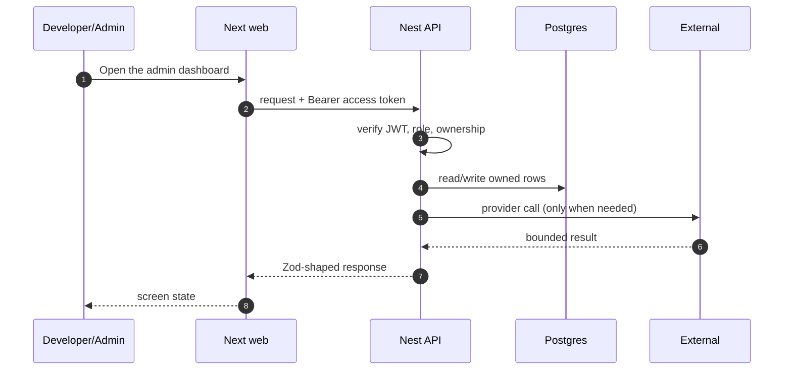

# FR-19 — Admin dashboard

> Story: US-19.1, US-19.2 · Sprint: 4 · Slice: 5 · Status: shipped
> Last updated: 2026-10-27

## 1. What it does (user view)

Admins see registered and logged-in users, suggestions/regenerations, status counts, AI usage by feature for a period and a freshness chip.

## 2. Why it exists (FR + acceptance criteria)

FR-19.1–19.11. Acceptance: Admin-only; counts; AI totals; period filter; data ≤5 minutes old.

## 3. Where it lives

`app/(app)/admin/page.tsx`, `app/(app)/admin/ai/page.tsx`, `apps/api/src/modules/admin/*`, `apps/api/src/modules/ai/ai-usage.service.ts`

## 4. How it works

1. `GET /admin/metrics` counts users, last-seen-in-30-days, SuggestionEvents and Selection statuses.
2. Results are cached in Redis for 300s; a stale marker is explicit.
3. `GET /admin/ai-usage?start&end&feature` groups AiUsage by feature.
4. `GET /admin/ai-settings/usage` returns settings plus the current month totals and percent.
5. The UI shows cards, a stacked status bar and a period selector; freshness is never hidden.

## 5. Sequence diagram

## 6. Data

`User`, `SuggestionEvent`, `Selection`, `IgnoredIssue`, `AiUsage`, `AiUsageDaily`, `AdminSnapshot` (worker aggregate).

## 7. Contract

`GET /admin/metrics`, `GET /admin/users`, `GET/PUT /admin/ai-settings`, `GET /admin/ai-settings/usage`, `GET /admin/ai-usage` (Admin). Errors: 400 invalid period, 403 non-Admin.

## 8. External calls, quota and fallback

None; all figures come from our database.

## 9. Authorization and failure modes

Controller-level `@Roles('ADMIN')`; the integration test proves a Developer gets 403 and an Admin 200.

## 10. Decisions and rejected alternatives

Five-minute Redis cache and a worker snapshot instead of a materialized view for the demo scale. Rejected: a paid analytics service.

## 11. Tests and evidence

Integration: Developer 403, Admin 200 and `AdminMetricsSchema` parse. Live dashboard in compose.

Evidence lives under `dev/evidence/slice-5/`. The PR body records the
exact commands and result.

## 12. Manual demo

Sign in as `admin@osh.dev` → `/admin` → change the period → `/admin/ai` shows settings vs usage.

## 13. Known limits and what would break it

Status counts are current, not historical; only suggestion/regeneration counts use the selected period. Data is cached up to 5 minutes.

## 14. Changelog

- 2026-10-27 — implemented and documented in the vertical build.
