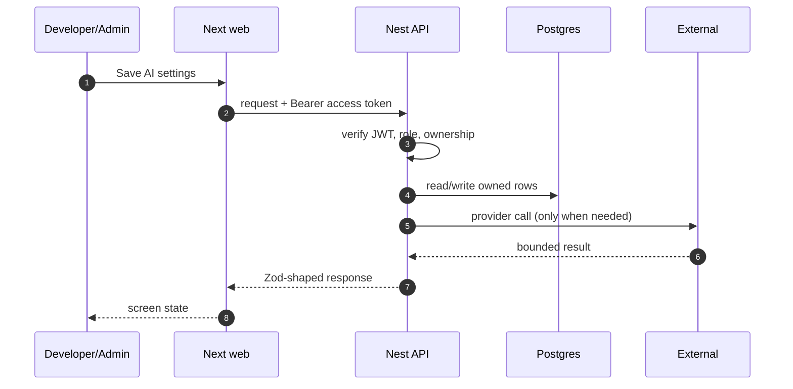

# FR-20 — AI settings and enforcement

> Story: US-20.1, US-20.2, US-20.3 · Sprint: 1 · Slice: 2 · Status: shipped
> Last updated: 2026-10-27

## 1. What it does (user view)

The Admin edits the monthly token limit per user, model temperature and platform USD limit, and sees current usage against the limit. Every AI feature reads the latest values and blocks before the provider call.

## 2. Why it exists (FR + acceptance criteria)

FR-20.1–20.10. Acceptance: valid values stored; invalid rejected; limits apply to CV, matching, onboarding and guide from the next request; users are told when blocked.

## 3. Where it lives

`app/(app)/admin/ai/page.tsx`, `apps/api/src/modules/ai/ai-settings.service.ts`, `ai-usage.service.ts`, `apps/api/src/modules/ai/prompts.ts`, `packages/contracts/src/account.ts`

## 4. How it works

1. `GET /admin/ai-settings` returns the singleton or creates it from env defaults.
2. `PUT` validates ranges (tokens 1k–2M, temperature 0–1, USD 0–10k) and stores `updatedById`.
3. Each AI service calls `assertAllowed(userId, feature, estimate)` which sums this month's tokens and platform cost.
4. A breach throws 429 with `AI_TOKEN_LIMIT`/`AI_USAGE_LIMIT`; no provider call happens.
5. After a successful call, usage is recorded and the remaining tokens are returned.

## 5. Sequence diagram

## 6. Data

`AiSetting` singleton `global`, `AiUsage`, `AiUsageDaily`. Admin changes are not versioned; the single row is the current policy.

## 7. Contract

`GET/PUT /admin/ai-settings`, `GET /admin/ai-settings/usage`, `GET /admin/ai-usage` (Admin). Errors: 400 invalid value, 403 non-Admin, 429 limit at the feature.

## 8. External calls, quota and fallback

Gemini; the limit is enforced before the fetch.

## 9. Authorization and failure modes

Admin-only; feature services use the stored singleton, not a client-supplied value. Users can only see their own conversation usage.

## 10. Decisions and rejected alternatives

Read settings on every AI request (a 1-row query) so changes apply immediately. Rejected: caching settings for an hour.

## 11. Tests and evidence

Contract rejects temperature 1.4; live admin page; ranking/guide calls showed token usage and the limit path returns 429 without a provider call.

Evidence lives under `dev/evidence/slice-2/`. The PR body records the
exact commands and result.

## 12. Manual demo

`/admin/ai` → lower the token limit → ask the guide again → limit banner; raise it and confirm recovery.

## 13. Known limits and what would break it

The cost figure is a blended estimate, not a provider invoice. The free tier may cost $0; the limit is a safety ceiling.

## 14. Changelog

- 2026-10-27 — implemented and documented in the vertical build.
