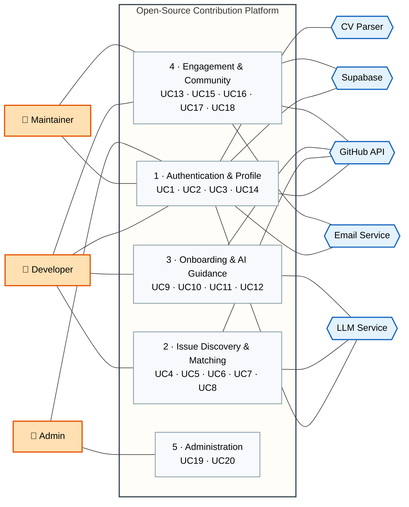
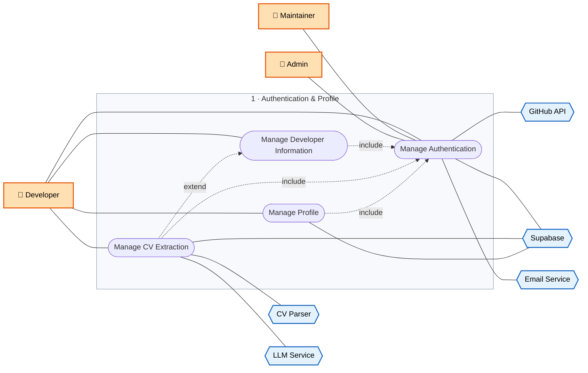
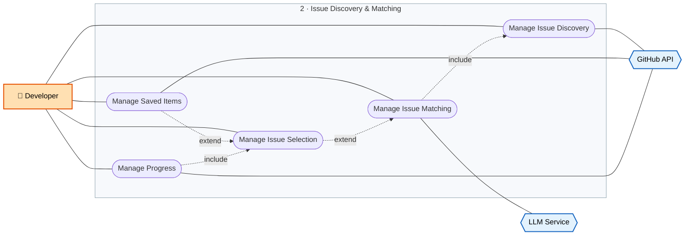
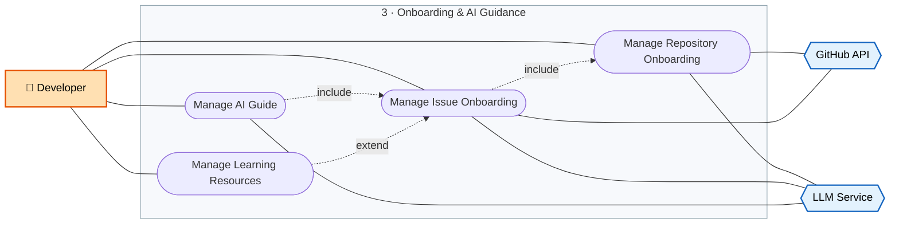
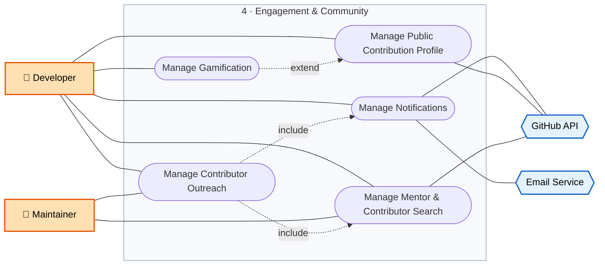
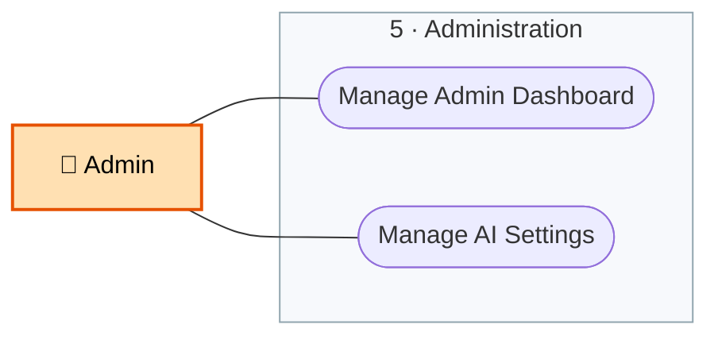

# **Use Case Diagram** 

The model is split into a system overview and five detailed module views. This keeps every use case readable, instead of forcing 20 use cases, 3 actors and 5 external systems onto one canvas.

**Legend**

- Solid line: association between an actor and a use case, or between a use case and an external system.
- Dotted arrow labelled `include`: the source use case always performs the target use case.
- Dotted arrow labelled `extend`: the source use case optionally adds behaviour to the target use case.

### **System Overview**

**Figure 1 — Actors, modules and external systems.** Each module box lists the use cases detailed in the figures below.

### **Module 1 — Authentication & Profile**

**Figure 2 — UC1 to UC3 and UC14.** Every other use case depends on this module through `include`.

Cross-module dependencies: UC13, UC15 and UC17 (module 4) and UC19 and UC20 (module 5) also include UC1.

### **Module 2 — Issue Discovery & Matching**

**Figure 3 — UC4 to UC8.** The contribution pipeline: discovery, matching, selection, saved items and progress.

Cross-module dependencies: UC4 includes UC2 (module 1); UC6 is included by UC9 (module 3); UC8 is included by UC16 (module 4).

### **Module 3 — Onboarding & AI Guidance**

**Figure 4 — UC9 to UC12.** Onboarding content and the AI guide, all without revealing the solution.

Cross-module dependency: UC9 includes UC6 (module 2).

### **Module 4 — Engagement & Community**

**Figure 5 — UC13, UC15 to UC18.** Notifications, public profile, gamification, mentor search and outreach.

Cross-module dependencies: UC13, UC15 and UC17 include UC1 (module 1); UC16 includes UC8 (module 2).

### **Module 5 — Administration**

**Figure 6 — UC19 and UC20.** Platform monitoring and AI usage control, available to the Admin only.

Cross-module dependency: UC19 and UC20 include UC1 (module 1).
